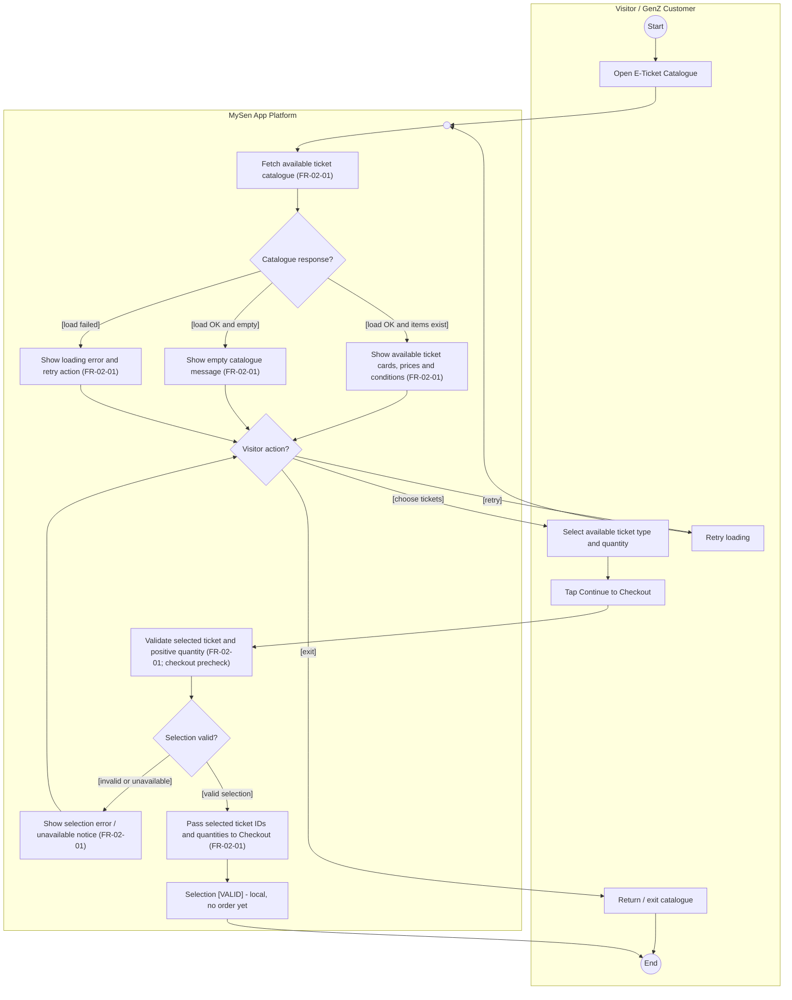

# AD-UC-02A — Browse E-Ticket Catalogue

> MySen App Platform · DBIZ2 Lesson 7 · Activity Diagram · Draft v1.0 (21/11/2026).  
> **Nguồn mã chuẩn:** GitHub `Function List/w0_scope.md` và `Function List/w1_function_list.md`. W0 có **UC-02**, không công nhận các mã Use Case con `UC-02A/B/D`; phần hậu tố A/B/D chỉ là cách đánh số **Activity Diagram**, không tạo Use Case mới.  
> **Nguyên tắc:** mỗi Activity ứng với đúng một FR L2 trong W1; các tác vụ bên trong không tạo mã FR L2 mới. Swimlane nghiệp vụ chỉ gồm khách hàng, MySen và hệ thống ngoài khi có tương tác thực tế. Các mã node là mã cục bộ trong file.  
> **Ngoài phạm vi:** Loyalty Coins, Voucher F&B và POS đổi voucher thuộc UC-05 / F-04.  
> **Lưu ý nguồn:** EARS W1 chỉ ghi các hành vi mức L2. Các quy tắc chi tiết như timeout 15 phút, retry cùng Order ID, webhook/idempotency, thủ tục Refund là quyết định/đề xuất triển khai từ bản thiết kế đang làm, **chưa được EARS W1 phê duyệt đầy đủ**.

## 1. Activity metadata

| Field | Description |
|---|---|
| Activity ID | `AD-UC-02A` |
| Activity Name | **Browse E-Ticket Catalogue** (đúng tên `FR-02-01` trong W1) |
| Parent Use Case | `UC-02` Purchase E-Tickets & Manage Wallet |
| Feature / Requirement | `F-02` / `FR-02-01` (Must; EQ) |
| Primary actor | Visitor / GenZ Customer |
| Swimlanes | Visitor / GenZ Customer; MySen App Platform |
| Trigger | Khách mở mục Tickets hoặc quay lại Catalogue từ Checkout/Wallet |
| Preconditions | Catalogue service khả dụng; không bắt buộc tạo Order. Đăng nhập là điều kiện dùng UC-02 theo W0, nhưng Screen Spec hiện chưa chốt có cho phép xem catalogue khi chưa đăng nhập; sơ đồ chỉ chặn tại bước Checkout. |
| Success | Danh mục có tên vé/giá hiển thị, vé và số lượng được chọn hợp lệ, điều hướng sang `S-F02-02` |
| Alternate ends | Empty catalogue, load failure, selection invalid, khách rời màn hình |
| Screen | `S-F02-01` → (thành công) `S-F02-02` |
| Source trace | W1 `FR-02-01-FE`, `FR-02-01-BE`; W0 UC-02; Screen Spec S-F02-01 |

## 2. Activity Diagram (Mermaid Pattern C, swimlanes)

**Cách đọc:** `d1` phân biệt tải thành công có dữ liệu, tải thành công nhưng rỗng và lỗi; `d2` là lựa chọn sau khi màn hình đã hiển thị trạng thái; `d3` chặn chuyển tiếp với lựa chọn không hợp lệ. `m0` là điểm hợp nhất luồng tải đầu tiên và retry; không tạo Order ở Catalogue. Giá chốt sẽ được kiểm tra lại tại `AD-UC-02B` / `FR-02-02`.

## 3. Node trace

| Node | Type | Meaning | Trace |
|---|---|---|---|
| `start`, `finish` | Initial / Final | Bắt đầu, kết thúc thao tác browse | UC-02 |
| `a1`, `a4`, `a5` | Actor actions | Mở, thử tải lại, thoát | FR-02-01 / S-F02-01 |
| `a2`, `a3` | Actor actions | Chọn vé/số lượng, tiếp tục | FR-02-01 → FR-02-02 (handoff) |
| `m0` | Merge | Gom lượt tải đầu và retry | control |
| `s1`, `s2` | System actions | Đọc và hiển thị catalog/giá/điều kiện | FR-02-01 |
| `s3`, `s4` | System actions | Trạng thái empty/error | FR-02-01 |
| `d1` | Decision | 3 trạng thái kết quả tải | FR-02-01 |
| `d2` | Decision | Retry / exit / select | FR-02-01 |
| `s5`, `d3`, `s6` | System action / Decision | Kiểm tra hợp lệ để chuyển Checkout; chặn lỗi | FR-02-01; FR-02-02 boundary |
| `s7`, `o1` | System / Object | Chuyển selection; **không phát sinh Order** | FR-02-01 → FR-02-02 |

## 4. Branch acceptance tests

| Branch | Given | When | Then |
|---|---|---|---|
| `d1 [load OK and items exist]` | Catalogue có vé đang bán | Khách mở Catalogue | Hiển thị tên/giá/điều kiện từ server |
| `d1 [load OK and empty]` | Không có vé khả dụng | Khách mở Catalogue | Thông báo rỗng; không tạo Order |
| `d1 [load failed]` | API trả lỗi | Khách mở Catalogue | Hiển thị lỗi và tùy chọn tải lại |
| `d2 [retry]` | Catalogue vừa tải lỗi | Khách chọn Retry | Tải lại qua `m0` |
| `d2 [exit]` | Khách đang xem Catalogue | Khách chọn Back | Rời màn hình, không tạo Order |
| `d2 [choose tickets]` | Catalogue hiển thị | Khách chọn vé và Continue | Chuyển qua kiểm tra lựa chọn |
| `d3 [invalid or unavailable]` | Quantity = 0 hoặc vé hết bán | Khách chọn Continue | Hiển thị lỗi, không chuyển sang Checkout |
| `d3 [valid selection]` | Ticket ID bán được, quantity > 0 | Khách chọn Continue | Sang S-F02-02 với selection; server revalidates at Checkout |

## 5. Object states and screens

| Object | State in this activity | Note |
|---|---|---|
| Ticket catalogue | available / empty / loading error | Trạng thái dữ liệu/hiển thị, chưa phải backend enum |
| Ticket selection | `VALID` local selection | Không phải `Order` hoặc `E-Ticket` |

Screen: `S-F02-01`; thành công chuyển `S-F02-02`. Không phát sinh modal mới.

## 6. Open questions

1. Khách chưa đăng nhập được xem Catalogue ở chế độ read-only không? W0 yêu cầu đăng nhập cho UC-02, Screen Spec chưa chốt chặn khi browse hay khi checkout.
2. Quy định max quantity, áp dụng vé hết chỗ và lọc catalogue theo loại vé do nhóm sản phẩm chốt; không tự đặt giới hạn.
3. Nếu giảng viên yêu cầu ký hiệu Initial/Final UML cụ thể, điều chỉnh style nhưng không thay đổi nghiệp vụ.

## 7. Verification checklist

- [x] Mỗi System Action có trace `FR-02-01` hoặc handoff sang `FR-02-02`.
- [x] Decision có guard riêng và đủ các nhánh trên sơ đồ.
- [x] Không phát sinh Order hoặc QR trên màn hình catalogue.
- [ ] Chưa đối chiếu line-by-line với Sequence gốc không hiện diện trong repository.
- [ ] Chưa xác minh bằng Mermaid Live Editor.
