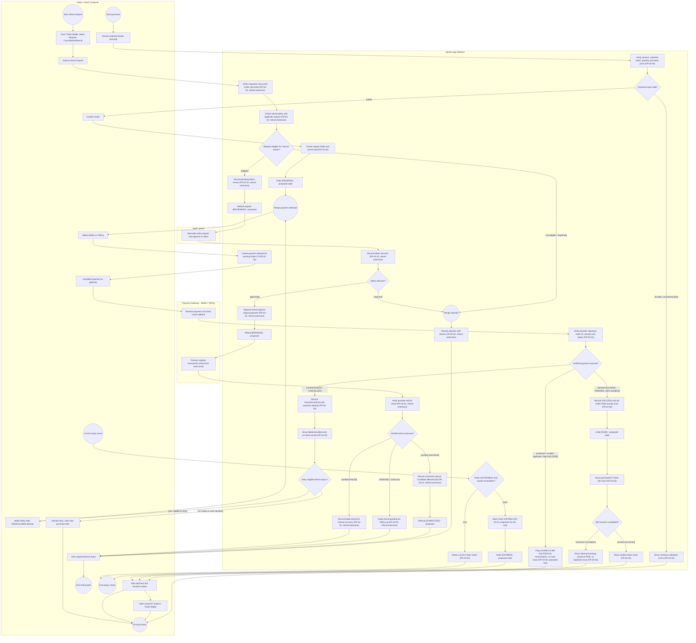

# AD-UC-02B — Ticket Checkout & Payment

> MySen App Platform · DBIZ2 Lesson 7 · Activity Diagram · Draft v1.0 (21/11/2026).  
> **Nguồn mã chuẩn:** GitHub `Function List/w0_scope.md` và `Function List/w1_function_list.md`. W0 có **UC-02**, không công nhận các mã Use Case con `UC-02A/B/D`; phần hậu tố A/B/D chỉ là cách đánh số **Activity Diagram**, không tạo Use Case mới.  
> **Nguyên tắc:** mỗi Activity ứng với đúng một FR L2 trong W1; các tác vụ bên trong không tạo mã FR L2 mới. Swimlane nghiệp vụ chỉ gồm khách hàng, MySen và hệ thống ngoài khi có tương tác thực tế. Các mã node là mã cục bộ trong file.  
> **Ngoài phạm vi:** Loyalty Coins, Voucher F&B và POS đổi voucher thuộc UC-05 / F-04.  
> **Lưu ý nguồn:** EARS W1 chỉ ghi các hành vi mức L2. Các quy tắc chi tiết như timeout 15 phút, retry cùng Order ID, webhook/idempotency, thủ tục Refund là quyết định/đề xuất triển khai từ bản thiết kế đang làm, **chưa được EARS W1 phê duyệt đầy đủ**.

## 1. Activity metadata

| Field | Description |
|---|---|
| Activity ID | `AD-UC-02B` |
| Activity Name | **Ticket Checkout & Payment** (đúng W1 `FR-02-02`; **không đặt tên Refund**) |
| Parent Use Case | `UC-02` Purchase E-Tickets & Manage Wallet |
| Feature / Requirement | `F-02` / `FR-02-02` (Must; EI) |
| Primary actor | Visitor / GenZ Customer |
| Supporting actors | Staff/Admin (manual refund check), Payment Gateway MoMo/VNPay |
| Swimlanes | Visitor; MySen App Platform; Staff/Admin; Payment Gateway |
| Entry event #1 | Người dùng chuyển selection từ `S-F02-01` sang Checkout `S-F02-02` |
| Entry event #2 (optional extension) | Sau khi đã mua vé, khách mở Ticket Wallet `S-F02-03` và chọn Request Cancellation/Refund |
| Preconditions | Khách đã đăng nhập cho giao dịch; selection hợp lệ; tiền và đơn hàng được backend xác thực |
| Primary success | Order thanh toán được xác minh và phát hành E-Ticket QR chính xác một lần |
| Refund extension | Theo quyết định nhóm: hành vi hủy/hoàn tiền nằm bên trong FR-02-02; **EARS GitHub W1 chưa mô tả luồng này**. Chỉ mô hình hóa request → manual review → provider result, không khẳng định quyền được hoàn tự động. |
| Screen | `S-F02-02` Checkout; `S-F02-03` chứa entry Refund và hiển thị kết quả (thuộc FR-02-03 về mặt truy xuất) |
| Source trace | W1 `FR-02-02-FE/BE/INT`; W0 mục Won't-have: Automatic Cash Refund for Tickets; Screen Specs S-F02-02/03 |

## 2. Activity Diagram (Mermaid Pattern C, swimlanes)

**Điểm thiết kế:** một Activity có **hai trigger độc lập** vì yêu cầu Refund không nhất thiết xảy ra ngay sau khi mua vé. Không đặt đường nối bắt buộc Purchase → Refund. Trigger của timer độc lập với luồng thao tác khách; kết quả chỉ quyết định từ trạng thái backend.

### Các quy tắc cần đọc cùng diagram

1. **Refund không phải Activity độc lập:** `startRefund` là entry khác **bên trong cùng `AD-UC-02B – Ticket Checkout & Payment`**, không có `UC-02B` hay mã FR Refund mới. Nếu không có refund request, toàn bộ nhánh này không chạy.
2. **Phân biệt hủy thanh toán và hủy vé:** provider `CANCELLED` trong giai đoạn checkout chỉ là *payment attempt cancelled*; chưa phải *ticket cancellation/refund*. Refund chỉ có thể bắt đầu với vé thuộc Order đã PAID và được phép xét duyệt.
3. **Hạn 15 phút là giả định thiết kế đã thống nhất**, tính từ lúc tạo Order. Retry (nếu đã biết attempt trước FAILED/CANCELLED và chưa hết hạn) giữ **cùng Order ID**, tạo **payment attempt** khác. Không được retry nếu còn một attempt có kết quả không xác định.
4. **Webhook/idempotency:** redirect về app không phải bằng chứng đã thanh toán. Callback trùng hoặc sai số tiền không làm phát hành QR lần nữa. SUCCESS hợp lệ sau khi Order EXPIRED phải được đối soát; không tự động cấp vé/hoàn tiền.
5. **Hoàn tiền cần Admin xác minh:** W0 loại trừ *automatic cash refund*. Chỉ xác nhận `Refund [COMPLETED]` sau khi kết quả provider được xác thực. QR chỉ vô hiệu hóa theo kết quả hoàn tiền thành công, và nếu cập nhật QR lỗi phải đối soát.
6. **Scope W1:** chỉ `FR-02-02` là FR chính thức trong Activity này; các tiểu bước Refund chưa có EARS riêng trong W1. `REVIEWING`, `PENDING`, `COMPLETED` của refund là **tên trạng thái đề xuất**, không phải danh mục enum được phê duyệt.

## 3. Node trace

| Node(s) | Type | Meaning | Trace |
|---|---|---|---|
| `startBuy`, `endBuy` | Initial / Final | Bắt đầu và kết thúc checkout | UC-02 / FR-02-02 |
| `v1`–`v8` | Visitor actions | Review, confirm, pay, retry, read result | FR-02-02; S-F02-02 |
| `s1`–`s4`, `op`, `mergePay` | System actions / Object / Merge | Kiểm tra selection, tạo Order, quản lý attempts | FR-02-02-FE/BE/INT |
| `s5`, `d2`, `s6`, `paid` | System / Decision / Object | Xác minh gateway, commit PAID | FR-02-02-BE/INT |
| `s7`–`s9`, `d3` | System / Decision | Phát hành QR, xử lý phát hành chậm | FR-02-02-BE |
| `s10`–`s12`, `d4` | System / Decision | Thất bại, retry hoặc đối soát | FR-02-02-BE/INT; design rules |
| `startTimer`, `d5`, `s13`, `expired`, `s14`, `endTimer` | Time event / System | Đóng đơn unpaid tại deadline | FR-02-02; proposed 15-min rule |
| `startRefund`, `endRefund`, `v9`–`v11` | Initial / Final / Visitor | Khách mở refund panel từ Wallet | FR-02-02 extension; S-F02-03 entry |
| `r1`, `r2`, `d6`, `r3`, `r4`, `reviewing` | System / Decision / Object | Ownership, eligibility, pending review | FR-02-02 extension (Draft) |
| `admin1`, `r5`, `d7` | External actor / System / Decision | Admin duyệt/thông báo kết quả | FR-02-02 extension (Draft); W0 Won't-have |
| `r6`, `refundPending`, `g2`, `r7`, `d8` | System / Gateway / Decision | Hoàn về provider gốc và xác nhận | FR-02-02 extension (Draft) |
| `r8`–`r10`, `refunded` | System / Object | Completed/Pending/Failed và QR | FR-02-02 extension (Draft) |
| `g1` | External action | Provider kết quả payment | FR-02-02-INT |

## 4. Branch acceptance tests

| Branch | Given | When | Then |
|---|---|---|---|
| `d1 [valid]` | Selection có vé khả dụng/quantity hợp lệ, đã đăng nhập | Khách xác nhận checkout | Order gắn đúng user, tổng tiền server tính |
| `d1 [invalid]` | Vé hết bán, quantity sai hoặc không login | Khách vào checkout | Báo lỗi, không tạo Order |
| `d2 [verified SUCCESS]` | Order PENDING, amount khớp, chưa cấp vé, còn hạn | Gateway trả SUCCESS đã xác minh | Set PAID đúng một lần; phát hành QR |
| `d2 [FAILED / CANCELLED]` | Order chưa trả tiền | Gateway xác nhận FAILED/CANCELLED | Không cấp QR; retry khi hợp lệ |
| `d2 [unknown / invalid / duplicate / late]` | Callback sai, trùng, pending hoặc tới sau expiry | Nhận callback | Không thay trạng thái đã hoàn tất; đối soát late/unknown |
| `d3 [issued]` | Order PAID, QR lưu xong | App xem trạng thái | Có vé hợp lệ để xem trong Wallet |
| `d3 [incomplete]` | Order PAID, QR cấp chưa xong | App xem trạng thái | Hiện processing, không phát sinh duplicate |
| `d4 [yes]` | FAILED, còn hạn và không có attempt in-flight | Khách chọn Retry | Tạo attempt mới, giữ Order ID |
| `d4 [no]` | Order hết hạn hoặc khách không retry | Khách dừng | Không phát hành vé |
| `d5 [yes]` | Order vẫn PENDING/unpaid ở 15 phút | Time event chạy | Chuyển EXPIRED |
| `d5 [no]` | Order đã PAID hoặc không còn eligible expire | Time event chạy | Giữ nguyên trạng thái |
| `d6 [eligible]` | Ticket của khách, Order PAID, policy cho xét | Khách gửi request | Ghi yêu cầu REVIEWING, chờ Admin |
| `d6 [not eligible]` | Vé không thuộc khách / policy không cho | Gửi request | Từ chối và nêu lý do |
| `d7 [approved]` | Request pending manual review | Admin duyệt | Gửi hoàn tiền cho provider gốc |
| `d7 [rejected]` | Admin từ chối | Admin gửi quyết định | Không gọi gateway refund |
| `d8 [SUCCESS]` | Provider xác minh hoàn tiền thành công | Callback đến | Record completed và vô hiệu hóa QR chịu tác động |
| `d8 [PENDING / unknown]` | Provider chưa có final result | Request status | Giữ pending và chờ đối soát, chưa vô hiệu hóa QR như đã hoàn |
| `d8 [FAILED]` | Provider xác nhận thất bại | Callback đến | Lưu trạng thái lỗi, cần xử lý thủ công; không báo đã hoàn |

## 5. Object states and screens

| Object | States used | Authority / note |
|---|---|---|
| Order | `PENDING`, `PAID`, `EXPIRED` | Thiết kế chi tiết; W1 EARS chưa ban hành enum |
| Payment attempt | initiated / `SUCCESS` / `FAILED` / `CANCELLED` / unknown | Kết quả từ gateway, tách với Order state |
| E-Ticket | not issued / issued / awaiting issuance / invalidated after refund | Trạng thái nghiệp vụ; enum chưa chốt |
| Refund request | `REVIEWING`, `PENDING`, `COMPLETED`, failed/recovery | **Draft extension**; không tự nhận là W1 enum |

Screens: `S-F02-02` cho checkout/payment; `S-F02-03` cho điểm truy cập refund + hiển thị trạng thái; người dùng từ `S-F02-01` chuyển sang Checkout. Không thêm Screen ID.

## 6. Open questions / gaps

1. W1 `FR-02-02` hiện không có acceptance criteria Refund: cần nhóm xác nhận phạm vi trước khi tuyên bố Diagram hoàn toàn trace được tới W1.
2. Ai là Admin có quyền duyệt? SLA, refund window, vé đã dùng/đã hết hạn, partial refund, lý do yêu cầu, giá trị hoàn lại: chưa được W0/W1 định nghĩa.
3. Gateway có hỗ trợ refund qua nguyên phương thức không? Cơ chế chứng thực kết quả, thất bại sau khi provider đã hoàn nhưng QR invalidation lỗi: cần thiết kế đối soát.
4. Timer và retry là quy tắc thiết kế đã thảo luận, chưa phải EARS của W1.
5. Xác nhận cách thể hiện 3 initial nodes trong một Activity hoặc dùng `Accept Event Action` nếu mẫu môn học yêu cầu đúng notation UML thay vì Mermaid Pattern C.

## 7. Verification checklist

- [x] Tên Activity **Ticket Checkout & Payment** trùng W1 `FR-02-02`.
- [x] Không dùng bất kỳ FR L2 chưa được W1 định nghĩa.
- [x] Refund nằm **bên trong AD-UC-02B**, không được đặt làm Activity riêng.
- [x] Refund chỉ sau khi có PAID ticket, không tự động chạy sau mua.
- [x] Tất cả decision có nhánh được gắn guard.
- [ ] Bản Sequence gốc chưa có trong GitHub để kiểm chứng message-to-node.
- [ ] Chưa xác minh sơ đồ trong Mermaid Live Editor.
