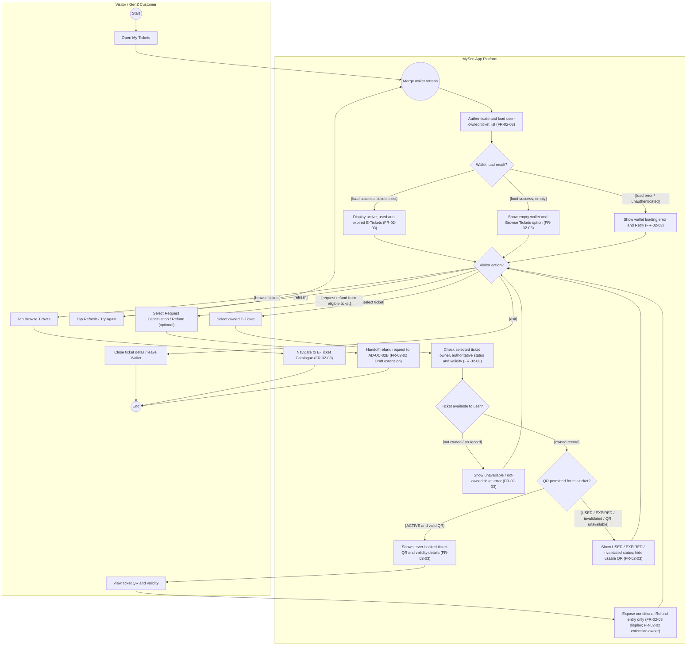

# AD-UC-02C — View & Manage Ticket Wallet

> MySen App Platform · DBIZ2 Lesson 7 · Activity Diagram · Draft v1.0 (21/11/2026).  
> **Nguồn mã chuẩn:** GitHub `Function List/w0_scope.md` và `Function List/w1_function_list.md`. W0 có **UC-02**, không công nhận các mã Use Case con `UC-02A/B/C`; phần hậu tố A/B/C chỉ là cách đánh số **Activity Diagram**, không tạo Use Case mới.  
> **Nguyên tắc:** mỗi Activity ứng với đúng một FR L2 trong W1; các tác vụ bên trong không tạo mã FR L2 mới. Swimlane nghiệp vụ chỉ gồm khách hàng, MySen và hệ thống ngoài khi có tương tác thực tế. Các mã node là mã cục bộ trong file.  
> **Ngoài phạm vi:** Loyalty Coins, Voucher F&B và POS đổi voucher thuộc UC-05 / F-04.  
> **Lưu ý nguồn:** EARS W1 chỉ ghi các hành vi mức L2. Các quy tắc chi tiết như timeout 15 phút, retry cùng Order ID, webhook/idempotency, thủ tục Refund là quyết định/đề xuất triển khai từ bản thiết kế đang làm, **chưa được EARS W1 phê duyệt đầy đủ**.

## 1. Activity metadata

| Field | Description |
|---|---|
| Activity ID | `AD-UC-02C` (đánh số Activity Diagram trong UC-02; không tạo Use Case mới) |
| Activity Name | **View & Manage Ticket Wallet** (đúng tên `FR-02-03` trong W1) |
| Parent Use Case | `UC-02` Purchase E-Tickets & Manage Wallet |
| Feature / Requirement | `F-02` / `FR-02-03` (Must; EQ) |
| Primary actor | Visitor / GenZ Customer |
| Swimlanes | Visitor / GenZ Customer; MySen App Platform |
| Trigger | Khách mở My Tickets độc lập, hoặc từ Checkout sau khi vé phát hành |
| Preconditions | Signed-in visitor; quyền sở hữu vé do backend xác minh |
| Success | Liệt kê vé active, used, expired và hiển thị QR chỉ khi ticket được phép sử dụng |
| Alternate ends | Wallet empty, load failure, invalid/non-owned ticket, QR unavailable |
| Cross-reference | Nút **Request Cancellation & Refund** là entry point gọi luồng Refund trong `AD-UC-02B` / `FR-02-02` (Draft). Wallet chỉ đọc/hiển thị ticket, không tự hoàn tiền. |
| Screen | `S-F02-03` Ticket Wallet; back to `S-F02-01` Browse Tickets |
| Source trace | W1 `FR-02-03-FE`, `FR-02-03-BE`; S-F02-03 Screen Spec |

## 2. Activity Diagram (Mermaid Pattern C, swimlanes)

**Cách đọc:** `s5` không thay đổi trạng thái ticket, chỉ đọc trạng thái từ backend. `s7` chỉ hiện credential QR hợp lệ khi server đã phát hành và vé đủ điều kiện; trạng thái USED/EXPIRED không phát ra mã QR còn dùng được. Nhánh Refund trong Wallet **không thực thi Refund** mà bàn giao cho `AD-UC-02B`; tính đủ điều kiện Refund phải kiểm tra lại tại đó.

## 3. Node trace

| Node(s) | Type | Meaning | Trace |
|---|---|---|---|
| `start`, `finish` | Initial / Final | Mở/đóng Wallet | UC-02 |
| `v1`–`v7` | Visitor action | Mở, chọn, xem, refresh, browse, yêu cầu refund, thoát | FR-02-03; v6 gọi FR-02-02 extension |
| `m0`, `s1` | Merge / System | Tải wallet từ đầu hoặc refresh | FR-02-03 |
| `d1`, `s2`–`s4` | Decision / System | Có vé / rỗng / lỗi | FR-02-03 |
| `d2` | Decision | Hành động tiếp theo của user | FR-02-03 |
| `s5`, `d3`, `s6` | System / Decision | Kiểm tra chủ sở hữu và quyền đọc | FR-02-03 |
| `d4`, `s7`, `s8` | Decision / System | Cho phép hiện QR hay ẩn theo trạng thái | FR-02-03 |
| `s9`, `v6`, `x1` | System / Actor / Handoff | Entry conditional Refund; không xử lý Refund tại Wallet | FR-02-03 → FR-02-02 (extension) |
| `v5`, `s10` | Actor / System | Trở về Catalogue | FR-02-03 → FR-02-01 |

## 4. Branch acceptance tests

| Branch | Given | When | Then |
|---|---|---|---|
| `d1 [tickets exist]` | User đăng nhập, có 2 vé | Mở Wallet | Hiện 2 vé với status server |
| `d1 [empty]` | User đăng nhập, không có vé | Mở Wallet | Hiện Empty State, không QR |
| `d1 [error]` | API lỗi hoặc phiên không hợp lệ | Mở Wallet | Thông báo lỗi / đăng nhập lại theo chính sách |
| `d2 [refresh]` | User đang ở Wallet | Chọn Refresh | Tải lại trạng thái, không tạo ticket |
| `d2 [browse tickets]` | User đang ở Wallet | Chọn Browse Tickets | Điều hướng về S-F02-01 |
| `d2 [exit]` | User muốn rời Wallet | Tap Back | Rời Wallet, không thay đổi dữ liệu |
| `d2 [select ticket]` | Wallet có ticket | Chọn item | Kiểm tra ownership & trạng thái |
| `d2 [request refund]` | User bấm Request Refund ở ticket đủ điều kiện hiển thị | Bấm nút | Gọi entry Refund ở AD-UC-02B; không tự refund |
| `d3 [not owned / no record]` | Ticket ID không thuộc user | Mở chi tiết | Từ chối, không hiển thị QR |
| `d3 [owned]` | Ticket ID thuộc user | Mở chi tiết | Xác minh tính hợp lệ của QR |
| `d4 [ACTIVE]` | Ticket còn hạn, chưa dùng, có QR hợp lệ | Xem chi tiết | Hiển thị QR server và thời hạn |
| `d4 [USED/EXPIRED/etc]` | Vé hết hạn/đã dùng/bị thu hồi | Xem chi tiết | Hiển thị status, không phát QR còn hiệu lực |

## 5. Object states and screens

| Object | States | Note |
|---|---|---|
| Ticket wallet | empty / populated / error / loading | UI states, không phải backend enum |
| E-Ticket | ACTIVE / USED / EXPIRED; invalidated/unissued when applicable | W1 xác nhận các nhóm active, used, expired; tên enum kỹ thuật cần chốt |
| QR | available only for issued, owned, valid ticket; otherwise hidden | FR-02-03-BE Wallet Data & Active QR Validation API |

Screen: `S-F02-03`; `S-F02-01` là đường điều hướng Browse; Refund xử lý ở `AD-UC-02B`.

## 6. Open questions

1. Ticket QR có được hiển thị dưới dạng watermark vô hiệu cho USED/EXPIRED không? Bản này không hiển thị credential sử dụng được.
2. Cách xử lý một Order PAID nhưng QR đang phát hành dở: hiển thị ticket processing (đề xuất), không coi là đã có QR.
3. Refund eligibility/panel do nhóm phê duyệt; chỉ giữ entry point liên kết, không lấn trách nhiệm `FR-02-02`.
4. Guard `[request refund from eligible ticket]` là kiểm tra hiển thị ban đầu, backend `AD-UC-02B` cần validate lại; không suy luận người dùng chắc chắn được hoàn.

## 7. Verification checklist

- [x] Tên Activity và FR đúng W1 `FR-02-03`.
- [x] Có các nhánh list/empty/error và các trạng thái ACTIVE/USED/EXPIRED.
- [x] Không biến Ticket Wallet thành nơi xử lý thanh toán hoặc Refund.
- [x] Không có voucher F&B hoặc coin.
- [ ] Chưa verify trực tiếp trên Mermaid Live.
