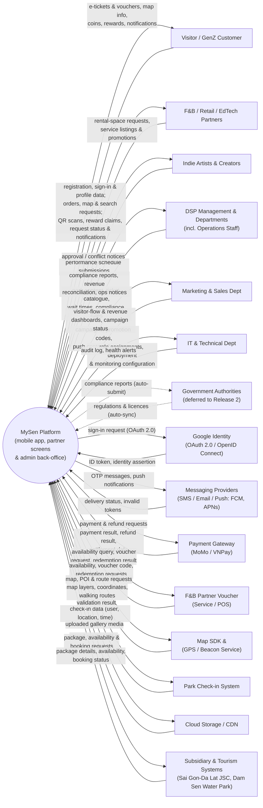

# Context Diagram: MySen Platform

Lesson 3. MySen Platform is one black box in the middle (covering scope F-01 to F-06 across the mobile app, partner screens, and admin back-office); around it are the external entities (people, organisations, and external systems/services) it exchanges data with. The Context Diagram answers "what does the system interact with?"; the [Use Case Diagram](../use-case/use-case-diagram.md) answers "who wants the system to do what?".

| Field | Value |
|---|---|
| Version | v2 |
| Built from | [CVCA](cvca.md): every stakeholder and external service that exchanges information with MySen Platform |

## Diagram

Time is not an external entity: timed behaviour (such as midnight daily streak resets and scheduled campaign notifications) is modelled as time-triggered flows in the Use Case and Activity Diagrams. Direct automated sync with Government Authorities is marked as deferred (`Won't-have` in Release 1).

## Data crossing the boundary

These are the core data groups exchanging across the system boundary, aligned with [W0 Scope](../function-list/w0-scope.md).

| Data group | Kept by | Reaches MySen Platform from |
|---|---|---|
| User accounts, roles & profiles | MySen Platform & Google Identity (read-only OAuth) | Visitor / GenZ Customer, Google Identity, IT & Technical Dept |
| E-tickets, orders & payment settlements | MySen Platform | Visitor / GenZ Customer, DSP Management, Payment Gateway (MoMo / VNPay) |
| Park map layers, POIs & wait times | MySen Platform & Map SDK | DSP Management & Operations Staff, Map SDK & GPS/Beacon Service |
| Quests, check-ins, XP, coins & badges | MySen Platform | Visitor / GenZ Customer, Park Check-in System |
| F&B loyalty vouchers & redemptions | MySen Platform & F&B Partner Voucher Service | Visitor / GenZ Customer, F&B Partner Voucher Service / POS |
| Social gallery media & community posts | MySen Platform & Cloud Storage / CDN | Visitor / GenZ Customer, Cloud Storage / CDN |
| Partner rentals, schedules & tour packages | MySen Platform & Subsidiary Systems | F&B / Retail / EdTech Partners, Indie Artists, Subsidiary & Tourism Systems |
| Campaigns, notifications & operational analytics | MySen Platform | Marketing & Sales Dept, Messaging Providers (FCM / APNs / SMS) |

## Change log

| Version | When | Change | Why |
|---|---|---|---|
| v1 | Lesson 3 | First version mapping core stakeholders and external systems from CVCA | Baseline context boundary for MySen Platform (F-01 to F-06) |
| v2 | Lesson 7 | Added Messaging Providers (FCM/APNs/SMS) and Park Check-in System details | Activity modeling (`AD-UC-04`, `AD-UC-05`) required push reminders and real-time checkpoint validation |
