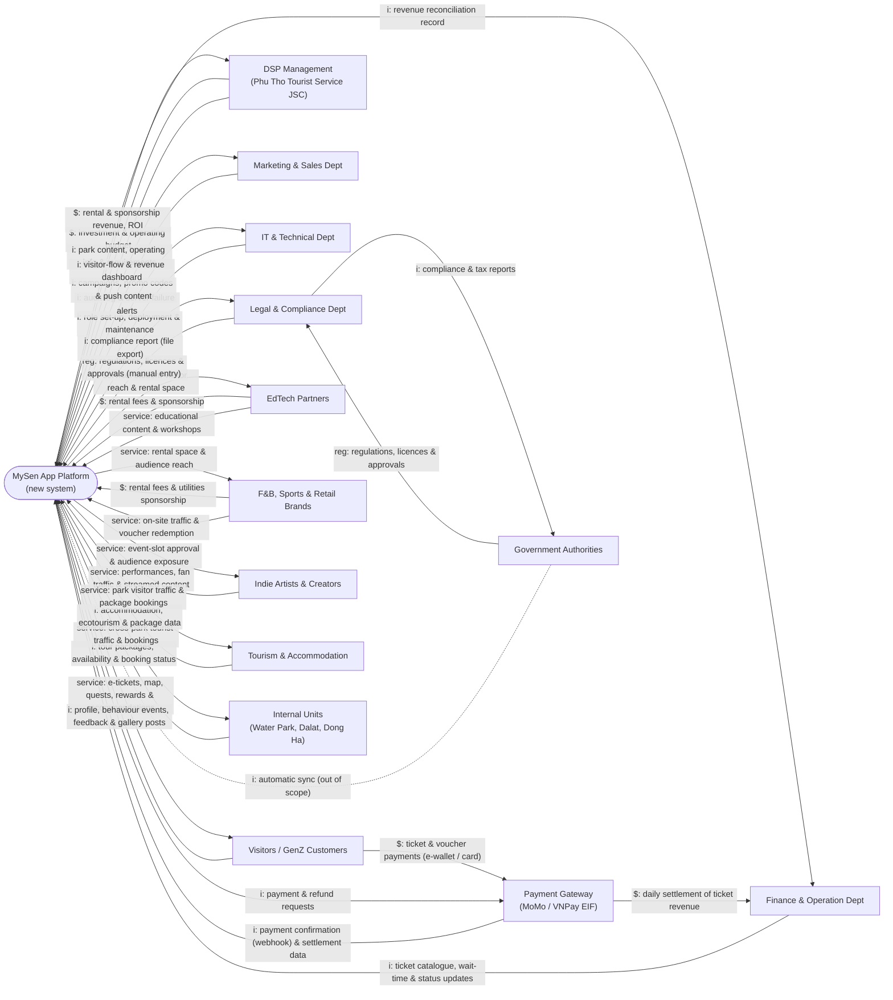

# CVCA: MySen App Platform

Lesson 3 (Prof. Seki, CVCA to Context Diagram). The Customer Value Chain Analysis lists every
stakeholder of the Dam Sen Cultural Park ecosystem and what flows between them: money (`$`), information (`i`),
goods or services (`service`), and regulations/approvals (`reg`). It is drawn to map value exchanges,
identify operational problems, and derive stakeholder requirements.

| Field | Value |
|---|---|
| Version | v1.0 (Lesson 3) |
| Next | [Context Diagram](context-diagram.md) |

## 1. Value chain (with the new system)

Before MySen, park ticketing, checkpoint exploration, partner booth promotions, and visitor engagement operated across disconnected offline channels (paper tickets, static maps, manual spreadsheets), causing long queues at gates and limited visibility into real-time visitor flow.

## 2. Problems and opportunities

| # | Stakeholder | Problem or opportunity |
|---|---|---|
| P-1 | Visitors / GenZ Customers, Finance & Operation Dept | On-site ticket queues are slow during peak hours, and visitors lack a unified digital wallet for e-tickets and cashless payments. |
| P-2 | Visitors / GenZ Customers | Traditional park visits lack interactive storytelling, real-time navigation, and gamified incentives to explore lesser-known attractions. |
| P-3 | F&B, Sports & Retail Brands, EdTech Partners, Indie Artists | Commercial partners and creators lack a digital channel to reach visitors on-site, manage space/event-slot bookings, and redeem loyalty vouchers. |
| P-4 | Marketing & Sales Dept, DSP Management | Management lacks real-time visitor-flow analytics, automated campaign/notification tools, and cross-unit booking visibility across affiliated parks. |
| P-5 | Legal & Compliance Dept, IT & Technical Dept | Compliance reporting and audit monitoring require structured digital exports and role-based system governance. |

## 3. Stakeholder requirements

Written as "<stakeholder> shall be able to ...", following Prof. Seki's Lesson 4 design process. They become system requirements in [the architecture](../architecture/architecture.md).

| ID | Stakeholder requirement | From |
|---|---|---|
| StR-01 | Visitors, partners, and internal staff shall be able to securely access the platform according to their assigned roles. | P-5 |
| StR-02 | Visitors shall be able to purchase e-tickets via online payment gateways and store QR tickets in a digital wallet. | P-1 |
| StR-03 | Visitors shall be able to navigate park zones and view real-time attraction details through an interactive map. | P-2 |
| StR-04 | Visitors shall be able to scan checkpoint QR codes to unlock interactive stories, earn XP, and collect badges. | P-2 |
| StR-05 | Visitors shall be able to earn loyalty coins from daily check-ins and redeem them for partner F&B vouchers. | P-2, P-3 |
| StR-06 | Visitors shall be able to share event photos in a community gallery, and commercial partners shall be able to submit space rental requests. | P-3 |
| StR-07 | Administrators and marketing staff shall be able to run promotional campaigns, send push notifications, and monitor visitor-flow and revenue analytics. | P-4, P-5 |