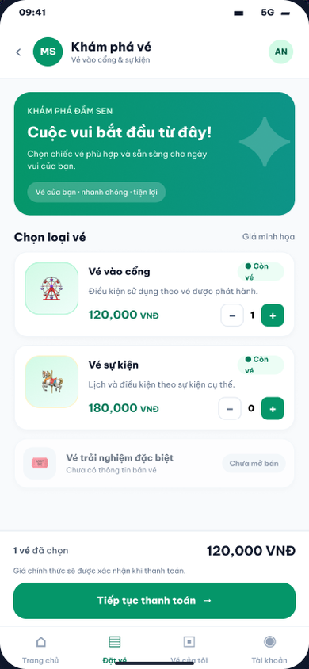
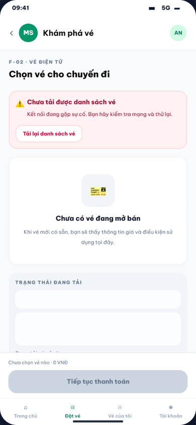

# Screen Spec: S-F02-01 Browse E-Ticket Catalogue

| Field | Value |
|---|---|
| Screen ID | `S-F02-01` |
| Screen name | Browse E-Ticket Catalogue |
| Actor | Visitor / GenZ Customer |
| Priority | Must |
| Feature | `F-02 E-Ticketing & Wallet` |
| Activity diagrams | `AD-UC-02A.md` |
| Mockup image | `img/S-F02-01.png` |
| Owner | Nguyễn Phạm Nguyệt Minh |
| Status | Complete Specification |

Document Owner: Nguyễn Phạm Nguyệt Minh | Last Updated: 2026-11-22

---

## 1. Purpose

**Shown when:** A visitor opens the Tickets feature or returns from Checkout or Ticket Wallet to browse the e-ticket catalogue. Ticket types, prices and availability must come from the system; prices shown in mockups are examples only.

**The user leaves this screen when:** The visitor selects a valid quantity and taps the Continue to Checkout action to open `S-F02-02`; Back and shared navigation follow the application shell.

**Source trace:** `AD-UC-02A.md` / `FR-02-01`. Ticket selection is passed to `FR-02-02` without creating an order on the catalogue screen.

## 2. Mockup

### Layout Overview
- **Top Navigation Bar:** Back action, round MS logo, catalogue title and user avatar.
- **Hero Header Area:** Introductory promotional card in the default state.
- **Main Catalogue Area:** Ticket cards with name, sales status, conditions, unit price and quantity stepper; unavailable tickets cannot be selected.
- **Status Area:** Catalogue load error, empty message and loading skeleton are alternative runtime states, not simultaneous conditions.
- **Bottom Fixed Action:** Selected-ticket count, estimated subtotal, pricing clarification and Continue to Checkout button.
- **Bottom Navigation Bar:** Home / Tickets / My Tickets / Account.

> Ticket prices and identifiers visible in screenshots are illustrative. Combined review imagery does not imply that different runtime states appear at the same time.

## 3. Element Inventory

| # | Element | Type | Content / Data Source | Required | Validation / Rule |
|---|---|---|---|---|---|
| 1 | `CatalogueHeader` | Header | Back, MS logo, catalogue title and avatar | Yes | Return to shared route; avatar belongs to application shell |
| 2 | `CatalogueFeatureLabel` | Text | Entry- and event-ticket descriptor; F-02 label in alternate state | Optional | Static description, not a new function identifier |
| 3 | `CatalogueIntro` | Hero / heading | Introductory message and ticket-selection guidance | Yes (default) | Must not replace server catalogue data |
| 4 | `TicketList` | List | Ticket cards supplied by Catalogue API / `FR-02-01` | Yes | Server determines sellability and availability |
| 5 | `TicketName` | Text | Ticket name, e.g., park admission or event ticket | Each card | Nonempty for a returned ticket type |
| 6 | `TicketPrice` | Text | Catalogue unit price in VND | Each available card | Read-only; server recalculates payable amount at checkout |
| 7 | `TicketConditions` | Text | Ticket usage or event conditions | Each available card | Do not infer validity periods; use supplied ticket terms |
| 8 | `AvailabilityLabel` | Chip | Available / Not yet on sale | Each card | Must use a text label; selection disabled if not on sale |
| 9 | `QuantitySelector` | Stepper | Decrement, quantity and increment for each ticket type | Sellable card | Non-negative integer; enforce configured server maximum if provided |
| 10 | `SelectedTicketsSummary` | Sticky summary | Selected count and estimated subtotal (sample: one ticket / 120,000 VND) | Yes | Client-side estimate only; does not create an Order |
| 11 | `ContinueCheckoutButton` | Primary CTA | Continue to Checkout | Yes | Disabled until at least one valid sellable ticket is selected |
| 12 | `SubtotalHelperText` | Helper text | Notice that final price is confirmed at checkout | Yes | Must not portray estimate as paid or finalized amount |
| 13 | `CatalogueStatusBanner` | Banner / skeleton | Load error, retry action, empty message and loading placeholders | Conditional | Error offers retry; empty/loading prohibit continuation |
| 14 | `BottomNavigation` | App shell | Home / Tickets / My Tickets / Account | Yes | Tickets tab selected; routes owned by shared shell |
| 15 | `DeviceStatusBar` | Device shell | 09:41, 5G and battery | Yes (mockup) | Device-frame illustration only |

## 4. States

| State | What the User Sees | Trigger |
|---|---|---|
| Default | Ticket cards, prices, conditions, quantity controls, estimated subtotal; CTA enabled only with valid selection | Catalogue returns sellable tickets |
| Empty | No tickets currently on sale; Continue action disabled | Catalogue returns no sellable tickets |
| Loading | Skeleton cards and loading indication; stepper and CTA disabled | Catalogue request in progress |
| Error | Catalogue unavailable message and Reload Ticket List action; no fabricated confirmed products | Network or API failure |
| Success / Confirmation | Selected count/subtotal updates and valid Continue action opens `S-F02-02`; no purchase has been confirmed | Valid selection submitted |

## 5. User Interaction & Events

| # | Element | User Action | System Response | Goes to Screen |
|---|---|---|---|---|
| 1 | `CatalogueHeader` | Tap Back | Leave without creating an order | Shared app route (TBD) |
| 2 | `TicketList` | Browse ticket cards | Display name, price, conditions and availability | Stays |
| 3 | `QuantitySelector` | Tap increment/decrement | Update nonnegative quantities and estimated total | Stays |
| 4 | `TicketConditions` | Expand ticket terms if available | Show full conditions within the card | Stays |
| 5 | `ContinueCheckoutButton` | Tap Continue to Checkout | Verify at least one valid selection; hand off items to checkout | `S-F02-02` |
| 6 | `ContinueCheckoutButton` | Attempt to proceed without valid selection | Keep action disabled and explain selection requirement | Stays |
| 7 | `CatalogueStatusBanner` | Tap Reload Ticket List | Refetch catalogue and revalidate retained selections | Stays |
| 8 | `BottomNavigation` | Change tab | Follow application shell navigation; no new FR | Corresponding shared route |

## 6. Screen-Level Rules

| Rule ID | Rule | Source |
|---|---|---|
| `SR-F02-01-01` | Display sales availability and prices from authoritative catalogue data; do not infer stock. | `FR-02-01` / `AD-UC-02A` |
| `SR-F02-01-02` | Quantities are nonnegative integers; tickets not on sale cannot be selected. | `FR-02-01`; handoff to `FR-02-02` |
| `SR-F02-01-03` | The catalogue subtotal is provisional; checkout must revalidate prices and quantities. | `FR-02-02` interface boundary |
| `SR-F02-01-04` | Empty, Loading and Error states must block continuation with unverified selection data. | `FR-02-01` |
| `SR-F02-01-05` | Continue does not create an Order; order creation is handled during checkout. | `AD-UC-02A` → `AD-UC-02B` |

## 7. Linked Requirements

| FR ID | Priority | What This Screen Does For It |
|---|---|---|
| `FR-02-01` | Must | Displays entry and event ticket catalogue with prices, as specified in W1. |
| `FR-02-02` | Must (related function) | Passes selected tickets to Checkout without processing payment on this screen. |

## 8. Responsive & Accessibility Notes

**Responsive Adaptations:**
- Reference design: 390 × 844 px mobile frame. Content must remain scrollable, and fixed actions must not obstruct interactive content or the onscreen keyboard.
- Visual system: Be Vietnam Pro, light background `#F8FAFC`, primary action color `#059669`. Visible product copy remains Vietnamese in the approved mockups; this specification is written in English.
- Touch targets must meet the UI Conventions minimum of 24 × 24 CSS pixels; larger targets are preferred for touch devices. Body text contrast must be at least 4.5:1.
- Availability, progress and error conditions require readable text, not color alone. Controls need accessible labels; asynchronous updates should be announced using an `aria-live`-equivalent region.
- The device status bar and shared bottom navigation belong to the application shell and do not introduce additional Screen IDs.

## 9. Open Questions

| # | Question | Blocking? | Default Applied |
|---|---|---|---|
| 1 | Which authoritative source defines actual ticket types, prices, terms and on-sale dates? | Yes | Unconfirmed; examples remain illustrative, no operating policy inferred. |
| 2 | What are per-type ticket quantity limits and the behavior when a limit is exceeded? | Yes | Unconfirmed; enforce server-configured limits when available. |
| 3 | What is the exact Back destination in the shared app shell? | No / To confirm | Use shared route; destination is not invented. |
| 4 | How should the combined Empty/Loading/Error review image map to runtime states? | No / To confirm | Render only the current applicable state at runtime. |
