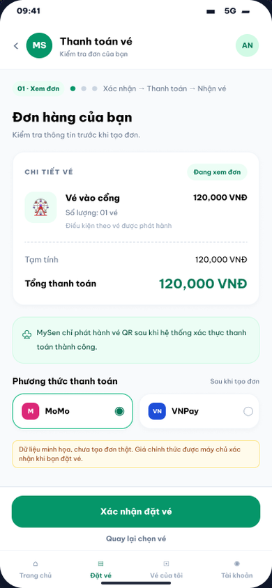
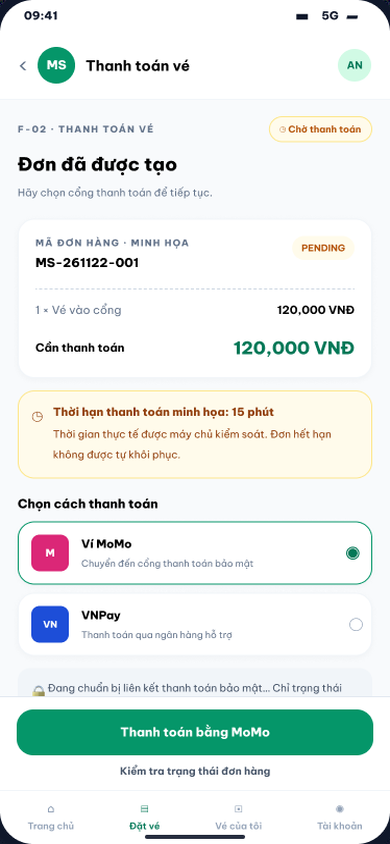
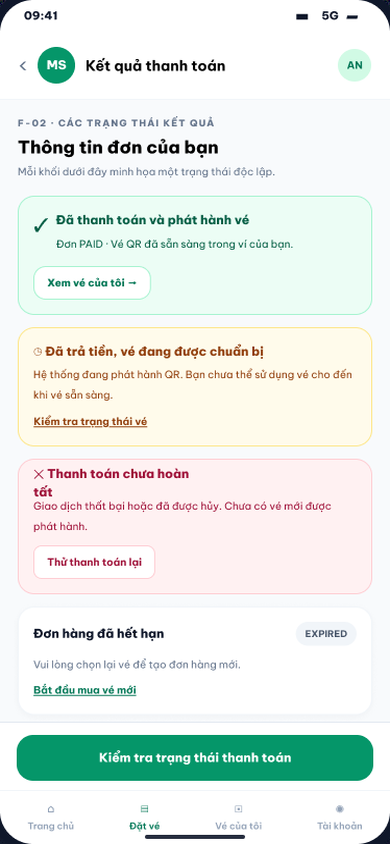

# Screen Spec: S-F02-02 Ticket Checkout & Payment

| Field | Value |
|---|---|
| Screen ID | `S-F02-02` |
| Screen name | Ticket Checkout & Payment |
| Actor | Visitor / GenZ Customer |
| Priority | Must |
| Feature | `F-02 E-Ticketing & Wallet` |
| Activity diagrams | `AD-UC-02B.md` |
| Mockup image | `img/S-F02-02.png` |
| Owner | Nguyễn Phạm Nguyệt Minh |
| Status | Complete Specification |

Document Owner: Nguyễn Phạm Nguyệt Minh | Last Updated: 2026-11-22

---

## 1. Purpose

**Shown when:** The visitor continues with tickets chosen on `S-F02-01`, to review the order, create an Order, pay through MoMo or VNPay, verify the payment and receive the result.

**The user leaves this screen when:** The visitor taps View My Tickets after ticket issuance, opening `S-F02-03`, or returns to `S-F02-01` before order creation or to start a new purchase where the order state permits.

**Source trace:** `AD-UC-02B.md` / `FR-02-02`. Ticket cancellation/refund requests are a proposed extension within the same FR; the current W1 EARS does not specify its detailed refund workflow.

## 2. Mockup

### Layout Overview
- **Top Navigation Bar:** MS logo, Back action, checkout title and avatar.
- **Order Review Area:** Ticket types, quantities, amount and Confirm Booking action.
- **Payment Stage:** Order reference, pending status, MoMo/VNPay selector, payment deadline information and provider-specific action.
- **Result Area:** Verification, success, failure and expiration are separate runtime states, even where combined in review screenshots.
- **Recovery Actions:** Check Status, Retry Payment and Start New Purchase appear only when applicable.
- **Bottom Navigation Bar:** Home / Tickets / My Tickets / Account.

> Prices, order identifiers and payment results shown in the mockups are illustrative. Multiple outcomes visible in a review image are mutually exclusive at runtime.

## 3. Element Inventory

| # | Element | Type | Content / Data Source | Required | Validation / Rule |
|---|---|---|---|---|---|
| 1 | `CheckoutHeader` | Header | MS logo, checkout/payment-result heading, Back and avatar | Yes | Safe Back behavior based on payment state |
| 2 | `CheckoutFeatureLabel` | Text / progress | F-02 label and Review → Confirm → Pay → Receive Ticket sequence | Optional | Visual progress is not authoritative server status |
| 3 | `OrderSummary` | Card | Ticket names, quantities, unit prices, provisional/final total | Yes (review) | All payable prices computed by server |
| 4 | `PayableAmount` | Amount | Server-confirmed Order total | Yes | Must equal amount sent to payment provider |
| 5 | `OrderIdText` | Text | Server-generated order ID; screenshot sample `MS-261122-001` | After order creation | Screenshot identifiers are illustrative only |
| 6 | `OrderStatusText` | Status chip | Pending / Paid / Expired | Conditional | Display server-authoritative order state only |
| 7 | `PaymentStatusText` | Status text | Verifying / Success / Failed / Cancelled | Conditional | Redirect return alone must not imply payment success |
| 8 | `ConfirmOrderButton` | Primary CTA | Confirm Booking | Review only | Enabled only for validated items and quantities |
| 9 | `PaymentMethodOptions` | Radio group | MoMo / VNPay | Pending only | Exactly one supported provider selected; never simulate provider approval |
| 10 | `PayWithProviderButton` | Primary CTA | Pay with MoMo / VNPay | Pending only | Only for eligible unexpired Order and configured provider |
| 11 | `PaymentSecurityNote` | Info banner | QR tickets are issued only after successful verified payment | Yes | Must not promise issuance while verification is pending |
| 12 | `PaymentHandoffBanner` | Progress banner | Handoff to secure payment gateway | Conditional | Payment URL/QR must originate from backend/provider |
| 13 | `PaymentResultBanner` | Result card | Verified payment and issued ticket; verification pending; failed or expired result | Conditional | Separate state messaging and actionable next step |
| 14 | `OrderExpiryInfo` | Warning banner | Illustrative 15-minute payment window | Conditional | Design assumption, not explicit current W1 EARS; server time governs |
| 15 | `RetryPaymentButton` | Secondary action | Retry Payment | Conditional | Server must permit retry on an eligible order; prevent duplicate charges |
| 16 | `StartNewPurchaseButton` | Secondary action | Start New Purchase | Expired | Start a new order flow; never revive an expired order |
| 17 | `ViewTicketsButton` | Primary / secondary CTA | View My Tickets | Confirmed payment + ticket issued | Enabled only after ticket/QR record exists |
| 18 | `RefreshStatusButton` | Secondary action | Check Status / Refresh Status | Pending / unknown | Read-only status refresh; no repeat payment initiation |
| 19 | `BottomNavigation` | App shell | Home / Tickets / My Tickets / Account | Yes | Tickets tab active |
| 20 | `DeviceStatusBar` | Device shell | 09:41, 5G, battery | Yes (mockup) | Device-frame illustration only |

## 4. States

| State | What the User Sees | Trigger |
|---|---|---|
| Default / Review | Order summary, payable total and Confirm Booking | Ticket selection received from `S-F02-01` |
| Empty | Prompt to select tickets; no Order created; return to catalogue | No tickets in selection |
| Loading / Verifying | Progress messaging with duplicate actions disabled; no live QR before confirmation | Order creation or payment verification in progress |
| Error | Specific failure explanation; Retry/New Purchase only when appropriate | Order creation failure, failed/cancelled payment, or expiry |
| Success / Confirmation | Verified success and View My Tickets navigation | Server confirms provider payment and QR tickets have been issued |

**UI-only substates:** `ORDER_REVIEW`, `PENDING`, `VERIFYING_PAYMENT`, `PAID_ISSUING`, `TICKET_READY`, `PAYMENT_NOT_COMPLETED`, `EXPIRED`. These are design labels, not assertions about a formally approved backend state enum.

## 5. User Interaction & Events

| # | Element | User Action | System Response | Goes to Screen |
|---|---|---|---|---|
| 1 | Entry from catalogue | Tap Continue to Checkout on `S-F02-01` | Revalidate ticket type, quantity and price; show summary | `S-F02-02` |
| 2 | `ConfirmOrderButton` | Tap Confirm Booking | Create one server-assigned Order with final amount; mark pending | Stays |
| 3 | `PaymentMethodOptions` | Select MoMo or VNPay | Record choice; do not mark paid | Stays |
| 4 | `PayWithProviderButton` | Tap Pay | Handoff using verified payment request | External provider; returns to `S-F02-02` |
| 5 | Return from gateway | Return to application | Fetch authoritative payment state from backend | Stays |
| 6 | Provider callback | Gateway sends payment result | Verify reference, amount and message authenticity; prevent duplicate ticket issuance | Stays |
| 7 | `PaymentResultBanner` | Receive verified success | Issue ticket/QR only after verification; show Ticket Processing if incomplete | Stays |
| 8 | `ViewTicketsButton` | Tap View My Tickets | Retrieve issued tickets owned by current visitor | `S-F02-03` |
| 9 | `RetryPaymentButton` | Tap Retry Payment | Check eligibility and retry policy before starting another attempt | Stays |
| 10 | `RefreshStatusButton` | Tap Check Status | Read stored status without reinitiating payment | Stays |
| 11 | `StartNewPurchaseButton` | Tap Start New Purchase | Return to catalogue for new selection/order | `S-F02-01` |
| 12 | Expiry event | Backend checks order deadline | Expire unpaid order and block ticket issuance | Stays |
| 13 | `CheckoutHeader` | Tap Back before order creation | Return to catalogue; after gateway handoff apply safe-exit policy | `S-F02-01` or approved safe route |
| 14 | Cancellation/refund extension | Submit request from Ticket Wallet | Check eligibility and route for manual review under proposed policy | Entry `S-F02-03`; business handling `FR-02-02` |

## 6. Screen-Level Rules

| Rule ID | Rule | Source |
|---|---|---|
| `SR-F02-02-01` | The server recalculates ticket prices and quantities at Order creation; catalogue subtotals are indicative. | `FR-02-02` / `AD-UC-02B` |
| `SR-F02-02-02` | Orders require a unique server ID; repeated button taps must not create duplicate Orders. | `FR-02-02` — implementation rule |
| `SR-F02-02-03` | Gateway callbacks must be verified server-side; returning to the app is not proof of success. | `FR-02-02` — implementation rule |
| `SR-F02-02-04` | Do not issue usable tickets or QR credentials before payment confirmation. | W1 EARS `FR-02-02` |
| `SR-F02-02-05` | Duplicate callbacks must not issue multiple tickets; amount and order reference must match. | `FR-02-02` — proposed safeguard |
| `SR-F02-02-06` | The 15-minute expiry shown in the draft must be confirmed by the team before release. | `AD-UC-02B` / design assumption |
| `SR-F02-02-07` | A genuine late success after expiry must not silently reactivate an expired Order; financial reconciliation remains unresolved. | `AD-UC-02B` — open question |
| `SR-F02-02-08` | Cancelling an unpaid payment attempt is distinct from cancelling/refunding an already paid ticket. | `AD-UC-02B` |
| `SR-F02-02-09` | Ticket refunds remain a proposed extension of `FR-02-02`; do not claim money was refunded without review and verified settlement. | W0 scope restriction; `AD-UC-02B` |

## 7. Linked Requirements

| FR ID | Priority | What This Screen Does For It |
|---|---|---|
| `FR-02-02` | Must | Reviews checkout, creates Orders, integrates MoMo/VNPay, displays payment verification and issues QR tickets after confirmed payment. Cancellation/refund remains a proposed extension, not accepted W1 EARS. |
| `FR-02-01` | Must (related function) | Receives catalogue-selected tickets and revalidates them before checkout. |
| `FR-02-03` | Must (related function) | Navigates to Ticket Wallet after ticket issuance. |

## 8. Responsive & Accessibility Notes

**Responsive Adaptations:**
- Reference design: 390 × 844 px mobile frame. Content must remain scrollable, and fixed actions must not obstruct interactive content or the onscreen keyboard.
- Visual system: Be Vietnam Pro, light background `#F8FAFC`, primary action color `#059669`. Visible product copy remains Vietnamese in the approved mockups; this specification is written in English.
- Touch targets must meet the UI Conventions minimum of 24 × 24 CSS pixels; larger targets are preferred for touch devices. Body text contrast must be at least 4.5:1.
- Availability, progress and error conditions require readable text, not color alone. Controls need accessible labels; asynchronous updates should be announced using an `aria-live`-equivalent region.
- The device status bar and shared bottom navigation belong to the application shell and do not introduce additional Screen IDs.

- MoMo/VNPay radio options need accessible labels; payment results must be announced in text and not by icon alone.
- On return from an external payment provider, always read verified backend status. Offer status refresh if connectivity fails.

## 9. Open Questions

| # | Question | Blocking? | Default Applied |
|---|---|---|---|
| 1 | Are payment retries, order-ID reuse, payment attempts and the 15-minute deadline formally approved? | Yes | Unconfirmed; do not interpret draft UX as production policy. |
| 2 | How are unknown provider callbacks, reconciliation and late verified successes handled? | Yes | Unconfirmed; no automatic refund or order revival presumed. |
| 3 | What recovery applies when payment succeeds but QR issuance is delayed or fails? | Yes | Show processing until a real ticket exists; recovery policy pending. |
| 4 | What are cancellation eligibility, manual approval roles and original-provider refund rules? | Yes | Proposed extension only; no automatic refund presumed. |
| 5 | Should the combined success/warning/error review mockup be separated into runtime states? | No / To confirm | Show only the state applicable to the actual transaction. |
