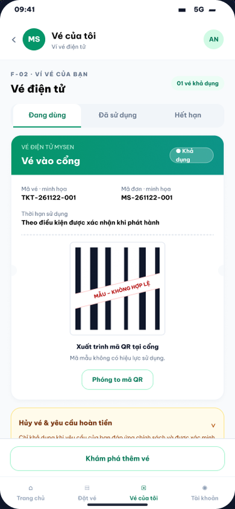
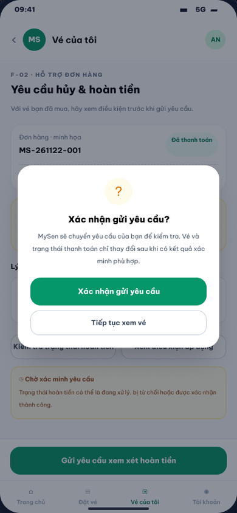
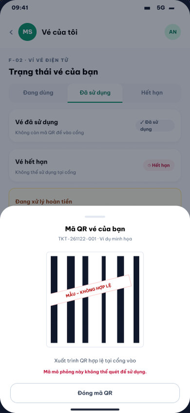

# Screen Spec: S-F02-03 View & Manage Ticket Wallet

| Field | Value |
|---|---|
| Screen ID | `S-F02-03` |
| Screen name | View & Manage Ticket Wallet |
| Actor | Visitor / GenZ Customer |
| Priority | Must |
| Feature | `F-02 E-Ticketing & Wallet` |
| Activity diagrams | `AD-UC-02C.md` (refund extension: `AD-UC-02B.md`) |
| Mockup image | `img/S-F02-03.png` |
| Owner | Nguyễn Phạm Nguyệt Minh |
| Status | Complete Specification |

Document Owner: Nguyễn Phạm Nguyệt Minh | Last Updated: 2026-11-22

---

## 1. Purpose

**Shown when:** A visitor opens My Tickets from the shared navigation or after confirmed payment and issuance. The list contains only tickets owned by the authenticated visitor.

**The user leaves this screen when:** They tap Browse More Tickets to open `S-F02-01`, or use the shared navigation. QR enlargement and refund-request confirmation are overlays within this same Screen ID.

**Source trace:** `AD-UC-02C.md` / `FR-02-03`; a cancellation/refund request entry links to the proposed extension of `AD-UC-02B.md` / `FR-02-02`.

## 2. Mockup

### Layout Overview
- **Top Navigation Bar:** MS logo, Back action, My Tickets title and avatar.
- **Segment Control:** Active / Used / Expired ticket tabs under one Screen ID.
- **Ticket Collection:** Cards with ticket name, state, ticket ID, Order reference and applicable usage terms from backend records.
- **QR Detail Area:** Protected QR for an issued valid ticket; enlarge via overlay/bottom sheet using the same Screen ID. The screenshot QR is a nonfunctional example.
- **Refund Section:** Optional reason field, request action and confirmation modal, conditional on an approved manual-review policy; this is a draft checkout/payment extension.
- **Bottom Navigation Bar:** Home / Tickets / My Tickets / Account.

> Ticket IDs, order IDs and QR graphics in the screenshots are examples only. Composite review images do not mean multiple interaction states occur simultaneously.

## 3. Element Inventory

| # | Element | Type | Content / Data Source | Required | Validation / Rule |
|---|---|---|---|---|---|
| 1 | `WalletHeader` | Header | MS logo, Back, My Tickets title and avatar | Yes | Shared navigation; data belongs to authenticated user |
| 2 | `WalletFeatureLabel` | Text | F-02 and e-ticket label | Optional | Static descriptor |
| 3 | `WalletHeading` | Heading | E-tickets heading and usable-ticket count | Yes | Count derived from returned ticket records |
| 4 | `TicketCollection` | Tabs + list | Active / Used / Expired tabs and ticket cards | Yes | Display only owned tickets, filtered by selected tab |
| 5 | `TicketName` | Text | Ticket name, such as park admission | Each ticket | Match issued ticket record |
| 6 | `TicketStatus` | Chip | Active / Used / Expired / verified refunded state | Each ticket | Based on server status, never appearance alone |
| 7 | `TicketIdText` | Text | Server ticket ID; screenshot sample `TKT-261122-001` | Each ticket | Screenshot sample not an actual credential |
| 8 | `OrderReference` | Text | Server order ID; sample `MS-261122-001` | Each ticket | Order must belong to signed-in visitor |
| 9 | `TicketValidity` | Text | Supplied validity/usage conditions | If supplied | Never invent a visit or expiration date |
| 10 | `TicketQrCode` | QR image | Backend-issued protected QR for valid ticket; mockup is non-scannable | Conditional | Do not expose usable QR for unissued or invalid tickets |
| 11 | `TicketQrHelpText` | Helper text | Present-at-gate guidance and Enlarge QR action | With QR | Use accessible label and readable ticket ID; do not place QR secret in alt text |
| 12 | `BrowseTicketsButton` | Secondary CTA | Browse More Tickets | Yes | Opens `S-F02-01` |
| 13 | `WalletStatusBanner` | Banner | Load error, expiration, request status or recovery message | Conditional | Must match server-authoritative status |
| 14 | `RefundPanelHeading` | Accordion / heading | Cancellation & Refund Request | Conditional / Draft | Only when eligibility is approved; no blanket refund promise |
| 15 | `RefundPolicyHint` | Info banner | Check eligibility before submitting a request | Conditional / Draft | Must not guarantee approval or repayment |
| 16 | `RefundReasonInput` | Input | Optional reason or supporting information | Conditional / Draft | Requiredness and character limit need team decision |
| 17 | `RequestRefundButton` | CTA | Submit Refund Review Request | Conditional / Draft | Reject duplicates; only for eligible tickets/orders |
| 18 | `RefundConfirmModal` | Modal | Confirm request submission; Confirm / Continue Viewing Tickets actions | Conditional / Draft | Submit only on confirmation; no automatic refund |
| 19 | `RefundStatusText` | Status banner | Pending Review / Rejected / Verified Refunded | Conditional / Draft | Do not show completion before approval and provider confirmation |
| 20 | `RefundRefreshButton` | Secondary button | Check Refund Status | Conditional / Draft | Read-only; do not resubmit the transaction |
| 21 | `QrExpandOverlay` | Bottom sheet / overlay | Enlarged QR for the selected ticket, with Close QR action | Conditional | Valid issued ticket only; mockup code is not usable |
| 22 | `BottomNavigation` | App shell | Home / Tickets / My Tickets / Account | Yes | My Tickets tab active |
| 23 | `DeviceStatusBar` | Device shell | 09:41, 5G, battery | Yes (mockup) | Device-frame illustration only |

## 4. States

| State | What the User Sees | Trigger |
|---|---|---|
| Default | Status tabs and ticket records; usable issued tickets provide a backend-backed QR | Visitor owns issued tickets |
| Empty | No tickets yet and Browse More Tickets action; no QR | Account has no tickets |
| Loading | Skeleton/progress; never show a realistic scannable placeholder | Ticket, QR or request-status retrieval in progress |
| Error | Specific problem with recovery guidance; no usable QR shown | Data error, access denial or ticket not issued |
| Success / Confirmation | Authorized valid ticket/QR shown; submitted refund request labeled Pending Review, not Refunded | Ticket issuance confirmed or request recorded |

**UI-only substates:** `ACTIVE`, `USED`, `EXPIRED` are ticket display groups. Draft refund labels `PENDING_REVIEW`, `REJECTED`, `CONFIRMED` are not claims of approved backend enumerations.

## 5. User Interaction & Events

| # | Element | User Action | System Response | Goes to Screen |
|---|---|---|---|---|
| 1 | Entry / `WalletHeader` | Open My Tickets | Validate session and ownership, fetch ticket list | `S-F02-03` |
| 2 | `TicketCollection` | Switch Active / Used / Expired tab | Filter using backend ticket states | Stays |
| 3 | `TicketCollection` | Select a ticket | Show its ticket ID, order reference, usage rules and applicable QR | Stays |
| 4 | `TicketQrCode` / `QrExpandOverlay` | Tap Enlarge QR | Show selected ticket's QR in a bottom sheet if valid | Stays (overlay) |
| 5 | `QrExpandOverlay` | Tap Close QR | Close sheet; preserve selection and active tab | Stays |
| 6 | `BrowseTicketsButton` | Tap Browse More Tickets | Open ticket catalogue | `S-F02-01` |
| 7 | `RefundPanelHeading` | Open request panel | Check ownership and display approved eligibility terms, if enabled | Stays |
| 8 | `RefundReasonInput` | Enter reason | Validate only under agreed refund policy | Stays |
| 9 | `RequestRefundButton` | Tap Submit Refund Review Request | Open confirmation dialog without submitting yet | Stays (modal) |
| 10 | `RefundConfirmModal` | Confirm request submission | Save one request and route to manual review under `FR-02-02` draft extension | Stays |
| 11 | `RefundConfirmModal` | Tap Continue Viewing Tickets | Close dialog without submitting | Stays |
| 12 | `RefundRefreshButton` | Tap Check Refund Status | Fetch latest review/payment result; do not start another transaction | Stays |
| 13 | `WalletStatusBanner` | Tap Retry after error | Reload ticket or status records | Stays |
| 14 | `BottomNavigation` | Switch app tab | Navigate using shared app shell | Corresponding route |

## 6. Screen-Level Rules

| Rule ID | Rule | Source |
|---|---|---|
| `SR-F02-03-01` | A visitor can retrieve only tickets/orders belonging to their authenticated account. | W0 login requirement; `FR-02-03` |
| `SR-F02-03-02` | Ticket Wallet lists Active, Used and Expired tickets according to backend statuses. | W1 EARS `FR-02-03` |
| `SR-F02-03-03` | Usable QR appears only after ticket issuance; sample graphics are never valid credentials. | `FR-02-02` + `FR-02-03` |
| `SR-F02-03-04` | Switching tabs, QR enlargement and ticket details remain internal states of one Screen ID. | `FR-02-03` |
| `SR-F02-03-05` | A refund-request entry may appear in Wallet; business processing traces to `AD-UC-02B` / `FR-02-02` draft extension. | `AD-UC-02B` |
| `SR-F02-03-06` | Submitting a refund request does not mean money has been refunded; approval and verified gateway result are required. | W0 scope restriction; `AD-UC-02B` |
| `SR-F02-03-07` | Invalid, expired or confirmed-cancelled QR tickets must not appear usable. | `FR-02-03` — proposed safeguard |
| `SR-F02-03-08` | Refresh Status reads records only and must not replay a financial operation. | `AD-UC-02B` — draft control |

## 7. Linked Requirements

| FR ID | Priority | What This Screen Does For It |
|---|---|---|
| `FR-02-03` | Must | Lists and manages Active/Used/Expired e-tickets and shows associated details/appropriate QR. |
| `FR-02-02` | Must (related function) | Receives tickets after verified purchase; exposes optional cancellation/refund request entry as a draft extension. |

## 8. Responsive & Accessibility Notes

**Responsive Adaptations:**
- Reference design: 390 × 844 px mobile frame. Content must remain scrollable, and fixed actions must not obstruct interactive content or the onscreen keyboard.
- Visual system: Be Vietnam Pro, light background `#F8FAFC`, primary action color `#059669`. Visible product copy remains Vietnamese in the approved mockups; this specification is written in English.
- Touch targets must meet the UI Conventions minimum of 24 × 24 CSS pixels; larger targets are preferred for touch devices. Body text contrast must be at least 4.5:1.
- Availability, progress and error conditions require readable text, not color alone. Controls need accessible labels; asynchronous updates should be announced using an `aria-live`-equivalent region.
- The device status bar and shared bottom navigation belong to the application shell and do not introduce additional Screen IDs.

- Tabs indicate selection with text and underline; expanded QR has a corresponding ticket name and readable ticket reference.
- Modal and bottom sheet require appropriate dialog roles and focus return to their invoking controls on close.
- Never disclose protected QR payloads in public alt attributes, screen descriptions or screenshots.

## 9. Open Questions

| # | Question | Blocking? | Default Applied |
|---|---|---|---|
| 1 | What determines Active/Used/Expired, validity dates and actual gate usage confirmation? | Yes | Unconfirmed; display only backend-provided status and terms. |
| 2 | What are cancellation/refund criteria, manual approval, mandatory reason and partial-refund policy? | Yes | Unconfirmed; refund UI remains a conditional draft extension. |
| 3 | Should a submitted request expose multi-stage progress or one review status? | No / To confirm | Use a single pending-review label until approved design. |
| 4 | How should combined historical tabs and overlays in review images behave at runtime? | No / To confirm | Render only active tab and current overlay. |
| 5 | How are real QR credentials generated, rotated or refreshed? | No / To confirm | No mechanism assumed; backend owns credentials. |
