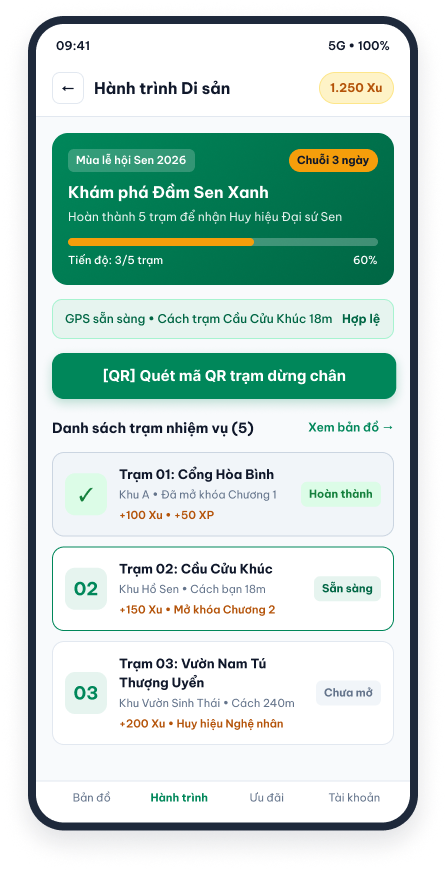
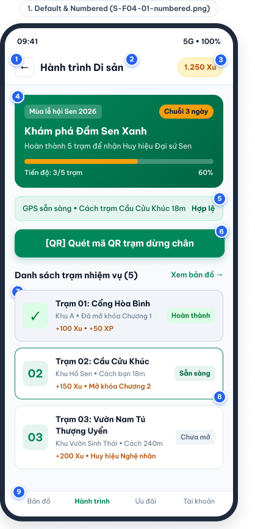
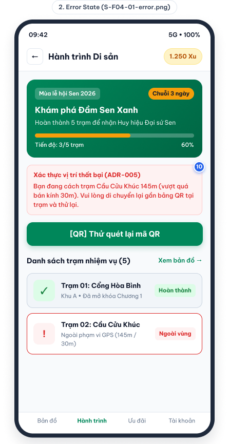

# Screen Spec: S-F04-01 Quest Hub & QR Scanner

| Field | Value |
| --- | --- |
| Screen ID | S-F04-01 |
| Screen name | Quest Hub & QR Scanner |
| Actor | Park Visitor |
| Priority | Must |
| Feature | F-04 Gamification & Loyalty |
| Activity diagrams | AD-UC-04 (actions "View checkpoint list", "Scan checkpoint QR", "Enter manual checkpoint code", "Verify QR & GPS geofence") |
| Mockup images | `img/S-F04-01.png` (default), `img/S-F04-01-numbered.png`, state images (section 2) |
| Frame width | 390px (exported at 3x, 1170 pixels; minimum supported 375px) |
| Figma frame | `MySen App / F-04 Gamification / S-F04-01` |
| Status | Reviewed |

## 1. Purpose

**Shown when:** the park visitor taps the **Khám phá (Quest)** tab or selects a heritage quest trail from the home dashboard to view available checkpoints and scan physical QR plaques in Dam Sen Park.

**The user leaves this screen when:** a checkpoint QR code or manual backup code is verified successfully (navigates to `S-F04-02` Storybook & Badge Reward), or the visitor switches to another bottom navigation tab (`S-F03-01` Map, `S-F02-03` Tickets, `S-F04-04` Vouchers).

## 2. Mockup

**Numbered:** each number corresponds to the `#` column of the element inventory in section 3 and matches the team numbering convention in [ui-conventions.md](../ui-conventions.md#7-component-numbering-rules-for-screen-id-numberedpng). Elements 5 and 6 appear in the active scanner / error state, so they are numbered on the scanner/error image.

| Default, numbered | Scanner / Error, numbered |
| --- | --- |
|  |  |

| State | Image |
| --- | --- |
| Default | `img/S-F04-01.png` |
| Empty | `img/S-F04-01-empty.png` |
| Loading | `img/S-F04-01-loading.png` |
| Error | `img/S-F04-01-error.png` (outside GPS geofence / invalid QR, `FR-04-02`) |
| Success | Transitions directly to `S-F04-02` (Storybook & Badge Unlock) |

All colours, fonts and corners come from the design tokens in [ui-conventions.md](../ui-conventions.md#6-design-tokens).

## 3. Element inventory

| # | Element | Type | Content / data source | Required | Validation |
| --- | --- | --- | --- | --- | --- |
| 1 | Header & Coin pill | Header bar | Screen title `"Hành trình Di sản"` + `user.coin_balance` (`#,### Xu`) | Yes | Format from `ui-conventions.md` §2 |
| 2 | Quest progress summary bar | Progress card | `quest.completed_count` / `quest.total_checkpoints`, `user.xp_total` | Yes | Numeric non-negative |
| 3 | Checkpoint list cards (`CP-01`..`CP-05`) | List of cards | `checkpoint.id`, `checkpoint.title`, `checkpoint.zone_name`, `checkpoint.status` (`Đã mở khóa` / `Chưa khám phá`) (`FR-04-01`) | Yes | Status shown by icon + pill + text |
| 4 | Scan Checkpoint QR button | Primary button | Label `"Quét mã QR trạm"` | Yes | Requests Camera & GPS permission on tap |
| 5 | Camera viewfinder frame | Scanner overlay | Live camera feed + QR alignment frame + torch toggle (`FR-04-02`) | No (scanner mode) | Must decode HMAC-signed QR payload (`ADR-005`) |
| 6 | Manual checkpoint code fallback | Input & button | Text input (`CP-XX` / 6-char plaque code) + `"Xác nhận mã"` secondary button | No (fallback / error) | Alphanumeric 6 chars, non-empty |

## 4. States

| State | What the user sees | Trigger |
| --- | --- | --- |
| Default | Header with Coin pill (`1.250 Xu`), quest progress bar (`2/5 trạm`), scrollable list of checkpoint cards (`CP-01`..`CP-05`) showing unlocked vs. locked states, and bottom primary button `"Quét mã QR trạm"`. | Screen opened, quest & checkpoint progress loaded (`FR-04-01`) |
| Empty (no data) | Illustration + `"Hiện chưa có hành trình thử thách nào đang mở. Vui lòng quay lại sau."` with link to `S-F03-01` Park Map. | No active quest campaigns configured in database |
| Loading | Skeleton placeholders for progress summary bar and 4 checkpoint cards; `"Quét mã QR trạm"` button disabled (`#CBD5E1`). | Fetching visitor's quest progress from backend |
| Error | Error banner (`#FEE2E2` bg, `#991B1B` text): `"Bạn đang ở ngoài phạm vi trạm CP-01. Vui lòng di chuyển lại gần điểm tham quan và thử lại."` (or invalid/duplicate QR message), plus manual code fallback input (`#6`). | GPS distance exceeds geofence radius or HMAC QR signature invalid (`FR-04-02`, `ADR-005`) |
| Success / confirmation | Toast `"Điểm danh thành công! +100 XP"` and immediate transition to `S-F04-02` displaying the unlocked story chapter and badge modal. | Server confirms valid QR signature + GPS proximity + first-time check-in (`FR-04-03`) |

## 5. Interactions and navigation

| # | Element | User action | System response | Goes to screen |
| --- | --- | --- | --- | --- |
| 1 | Coin pill (`#1`) | tap | Opens loyalty wallet & voucher catalog | S-F04-04 |
| 2 | Completed checkpoint card (`#3`) | tap | Opens previously unlocked story chapter | S-F04-02 |
| 3 | Locked checkpoint card (`#3`) | tap | Shows checkpoint location hint on interactive map | S-F03-01 |
| 4 | Scan Checkpoint QR button (`#4`) | tap | Opens camera viewfinder (`#5`) and acquires device GPS coordinates | stays (scanner overlay) |
| 5 | Camera viewfinder (`#5`) | scan QR | Sends QR token + GPS lat/lng to backend for validation (`SD-UC-04`) | S-F04-02 (on valid) or stays (error state) |
| 6 | Manual code fallback (`#6`) | submit code | Validates plaque code + GPS coordinates when camera scan fails | S-F04-02 (on valid) or stays (error state) |

## 6. Screen-level rules

| Rule ID | Rule | Source |
| --- | --- | --- |
| SR-001 | Both the cryptographic HMAC QR token and device GPS coordinates within the checkpoint geofence radius must pass validation before unlocking a chapter or awarding XP. | `ADR-005`, `BR-04` |
| SR-002 | Each checkpoint can award XP and unlock its badge only once per visitor account; re-scanning a completed checkpoint opens the story reader without duplicating rewards. | `FR-04-02`, `BR-05` |
| SR-003 | If device GPS permission is denied or unavailable, display an actionable prompt to enable Location Services before submitting a scan. | `FR-04-02` |
| SR-004 | Checkpoint completion states (`Đã mở khóa` vs. `Chưa khám phá`) must differ by both badge icon and text label, never by colour alone. | `ui-conventions.md` §5 |

## 7. Linked requirements

| FR ID | What this screen does for it |
| --- | --- |
| FR-04-01 | Displays the visitor's active heritage quest progress and checkpoint completion statuses |
| FR-04-02 | Captures checkpoint QR code (or manual plaque code) alongside GPS coordinates and validates anti-cheat rules |
| FR-04-03 | Triggers XP credit, badge unlock, and transition to the unlocked story chapter upon valid check-in |

## 8. Responsive and accessibility notes

- Smallest supported width: `375px` (base design `390px`); checkpoint cards stack vertically in a single column with `16px` horizontal screen padding.
- Touch targets for `"Quét mã QR trạm"` (`height: 48px`), manual input button, and checkpoint cards meet the minimum `44 × 44 CSS pixels` rule (`WCAG 2.2, 2.5.8`).
- Body text and error banner contrast ratios exceed `4.5:1` (`WCAG 2.2, 1.4.3`).

## 9. Open questions

| # | Question | Blocking? | Status |
| --- | --- | --- | --- |
| 1 | [NEEDS CLARIFICATION: What is the exact default GPS geofence radius (e.g., 30m vs. 50m) for indoor/shaded pavilions in Dam Sen Park?] | No | Open. Default: `50m` radius with manual plaque code fallback (`#6`). |

---

## Completion checklist

- [x] The mockup is a separate cropped image file, named with the Screen ID, at the frame width.
- [x] The numbered image exists, and its numbers match the `#` column of the element inventory.
- [x] Every visible element in the mockup appears in the element inventory.
- [x] Every colour in the mockup is a design token from `ui-conventions.md`.
- [x] Every input element has a validation rule or an explicit `"none"`.
- [x] All five states are filled in.
- [x] Every navigation target is a Screen ID that exists in the Screen List.
- [x] Every element that displays data names the field it displays.
- [x] Every linked FR exists in the Function List, and every action of this screen in `AD-UC-04` is covered by an interaction row.