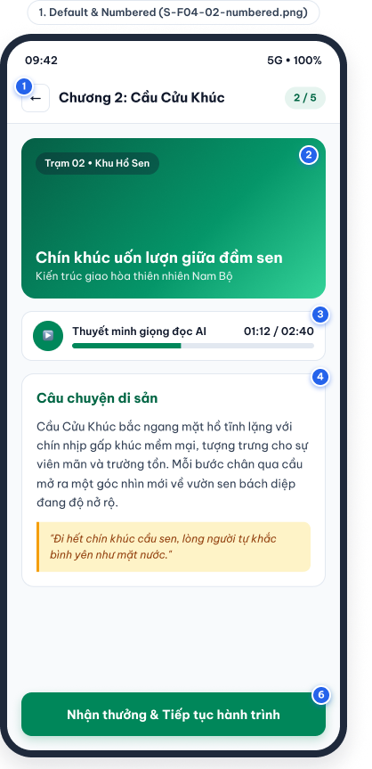
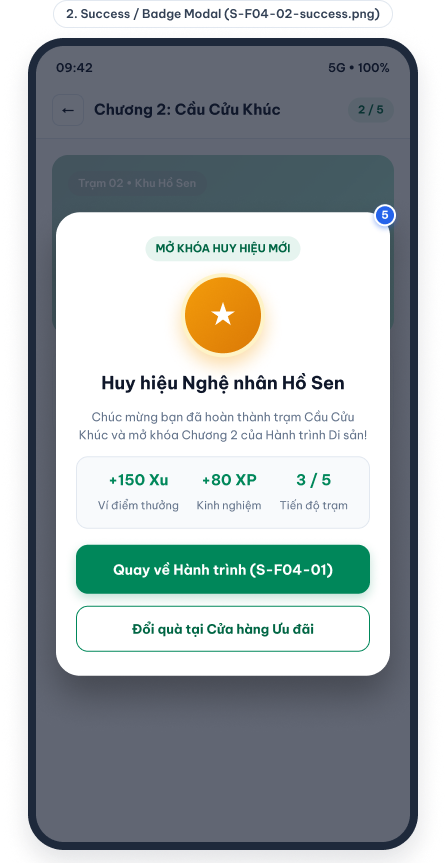

# Screen Spec: S-F04-02 Storybook Reader & Badge Unlock

| Field | Value |
|---|---|
| Screen ID | S-F04-02 |
| Screen name | Storybook Reader & Badge Unlock |
| Actor | Park Visitor |
| Priority | Must |
| Feature | F-04 Gamification & Loyalty |
| Activity diagrams | AD-UC-04 (actions "Unlock story chapter", "Award XP & badge", "Read heritage story") |
| Mockup images | `img/S-F04-02.png` (default), `img/S-F04-02-numbered.png`, state images (section 2) |
| Frame width | 390px (exported at 3x, 1170 pixels; minimum supported 375px) |
| Figma frame | `MySen App / F-04 Gamification / S-F04-02` |
| Status | Reviewed |

## 1. Purpose

**Shown when:** the park visitor successfully verifies a checkpoint QR code (or manual plaque code) on `S-F04-01`, or taps an already unlocked checkpoint card to re-read its cultural heritage story.

**The user leaves this screen when:** the visitor closes the badge reward modal and finishes reading the story chapter, tapping the back button to return to `S-F04-01` (Quest Hub) or navigating to `S-F04-04` (Loyalty Vouchers) to spend newly earned coins.

## 2. Mockup

**Numbered:** each number corresponds to the `#` column of the element inventory in section 3 and matches the team numbering convention in [ui-conventions.md](../ui-conventions.md#7-component-numbering-rules-for-screen-id-numberedpng). Elements 5 and 6 appear in the first-time unlock celebration modal, so they are numbered on the unlock modal image.

| Default, numbered | Unlock modal, numbered |
|---|---|
|  |  |

| State | Image |
|---|---|
| Default (Story Reader) | `img/S-F04-02.png` |
| Unlock Celebration (Modal) | `img/S-F04-02-modal.png` |
| Loading | `img/S-F04-02-loading.png` |
| Error | `img/S-F04-02-error.png` (audio/media load failure, `FR-04-04`) |

All colours, fonts and corners come from the design tokens in [ui-conventions.md](../ui-conventions.md#6-design-tokens).

## 3. Element inventory

| # | Element | Type | Content / data source | Required | Validation |
|---|---|---|---|---|---|
| 1 | Back button | Button | Static (`←` icon) | Yes | None |
| 2 | Chapter cover illustration | Image container | `story.cover_image_url`, `checkpoint.id` badge (`CP-02`) | Yes | Fallback placeholder if offline |
| 3 | Heritage story title & audio guide toggle | Header & player control | `story.title`, `story.read_time`, `story.audio_url` (`"Nghe thuyết minh"`) (`FR-04-04`) | Yes | Audio duration format `mm:ss` |
| 4 | Story body text | Scrollable rich text | `story.content_paragraphs`, `story.cultural_fact_box` (`FR-04-04`) | Yes | Supports Vietnamese & English locale |
| 5 | Badge unlock modal & close (`X`) button | Modal overlay | `badge.icon_url`, `badge.title` (`"Huy hiệu Sứ giả Sen"`), `reward.xp_earned` (`+100 XP`), `reward.coins_earned` (`+150 Xu`) (`FR-04-03`) | No (first unlock only) | Displayed once per checkpoint unlock |
| 6 | Claim XP & Continue button | Primary button | Label `"Nhận thưởng & Đọc truyện"` inside unlock modal (`FR-04-03`) | No (first unlock only) | Dismisses modal and reveals full story |

## 4. States

| State | What the user sees | Trigger |
|---|---|---|
| Unlock Celebration (Modal) | Dimmed backdrop over the story reader with a centered celebration card (`#5`) showing the unlocked badge artwork, `+100 XP` & `+150 Xu` reward pills, close (`X`) button, and primary button `"Nhận thưởng & Đọc truyện"` (`#6`). | First-time valid checkpoint QR check-in completed (`FR-04-03`, `SD-UC-04`) |
| Default (Story Reader) | Clean reading view with back button (`#1`), cultural landmark illustration (`#2`), chapter title + interactive audio narration bar (`#3`), and formatted heritage story text (`#4`). | Visitor dismisses the unlock modal or opens an already completed checkpoint from `S-F04-01` (`FR-04-04`) |
| Loading | Skeleton placeholders for cover artwork, title lines, and paragraph blocks while fetching story media. | Story content or audio metadata is being fetched from backend |
| Error | Non-blocking error banner (`#FEE2E2` bg, `#991B1B` text): `"Không thể tải tệp âm thanh thuyết minh. Vui lòng kiểm tra mạng và thử lại."` with `"Thử lại"` action while keeping offline-cached text readable. | Audio stream or high-res illustration fails to load (`FR-04-04`) |

## 5. Interactions and navigation

| # | Element | User action | System response | Goes to screen |
|---|---|---|---|---|
| 1 | Back button (`#1`) | tap | Closes reader (and pauses audio if playing) | S-F04-01 |
| 2 | Audio guide toggle (`#3`) | tap | Plays or pauses Vietnamese/English voice narration | stays |
| 3 | Close modal (`X`) button (`#5`) | tap | Dismisses badge celebration modal (rewards already credited) | stays (Default reader) |
| 4 | Claim XP & Continue button (`#6`) | tap | Dismisses modal, updates header XP/Coin state, and focuses story text | stays (Default reader) |
| 5 | Share badge action (optional link in modal) | tap | Pre-fills unlocked badge card into social post composer (`FR-04-05`) | S-F05-01 |

## 6. Screen-level rules

| Rule ID | Rule | Source |
|---|---|---|
| SR-001 | XP and loyalty coins are credited atomically on the server upon valid check-in (`SD-UC-04`); dismissing the modal via `X` or `"Nhận thưởng & Đọc truyện"` never double-credits or forfeits rewards. | `FR-04-03`, `BR-05` |
| SR-002 | Re-opening a previously completed checkpoint opens directly in the Default (Story Reader) state without re-triggering the badge unlock modal (`#5`). | `BR-05` |
| SR-003 | Story text and unlocked badge metadata must remain readable even if the optional audio narration stream fails to load. | `ui-conventions.md` §4 |
| SR-004 | All badge status labels and reward pills must combine icon and explicit Vietnamese text (`+100 XP`, `+150 Xu`), adhering to contrast minimums (`≥ 4.5:1`). | `ui-conventions.md` §5 |

## 7. Linked requirements

| FR ID | What this screen does for it |
|---|---|
| FR-04-03 | Displays the newly unlocked heritage badge, XP gain, and loyalty coin reward upon first checkpoint completion |
| FR-04-04 | Renders the unlocked cultural story chapter with text and audio narration controls |
| FR-04-05 | Allows visitors to share their unlocked milestone badge to the park social gallery (`S-F05-01`) |

## 8. Responsive and accessibility notes

* Smallest supported width: `375px` (base design `390px`); story paragraphs use `14px` body size (`Be Vietnam Pro`) with `1.6` line-height and `16px` horizontal margins for comfortable outdoor mobile reading.
* The badge unlock modal (`#5`) caps at `342px` width on `390px` viewports with at least `44 × 44 CSS pixels` touch target on both the close (`X`) button and `"Nhận thưởng & Đọc truyện"` primary button (`WCAG 2.2, 2.5.8`).
* Text contrast on story paragraphs (`#334155` on `#FFFFFF`, `10.3:1`) and reward pills exceeds `WCAG 2.2, 1.4.3` (`4.5:1`).

## 9. Open questions

| # | Question | Blocking? | Status |
|---|---|---|---|
| 1 | [NEEDS CLARIFICATION: Should audio narration files be pre-cached when the visitor enters the park Wi-Fi zone to prevent cellular buffering?] | No | Open. Default: stream on demand with graceful text-only fallback. |

## Completion checklist

- [x] The mockup is a separate cropped image file, named with the Screen ID, at the frame width.
- [x] The numbered image exists, and its numbers match the # column of the element inventory.
- [x] Every visible element in the mockup appears in the element inventory.
- [x] Every colour in the mockup is a design token from `ui-conventions.md`.
- [x] Every input element has a validation rule or an explicit `"none"`.
- [x] All states (Unlock Modal, Default Reader, Loading, Error) are filled in.
- [x] Every navigation target is a Screen ID that exists in the Screen List (`S-F04-01`, `S-F05-01`).
- [x] Every element that displays data names the field it displays.
- [x] Every linked FR exists in the Function List, and every action of this screen in `AD-UC-04` is covered by an interaction row.