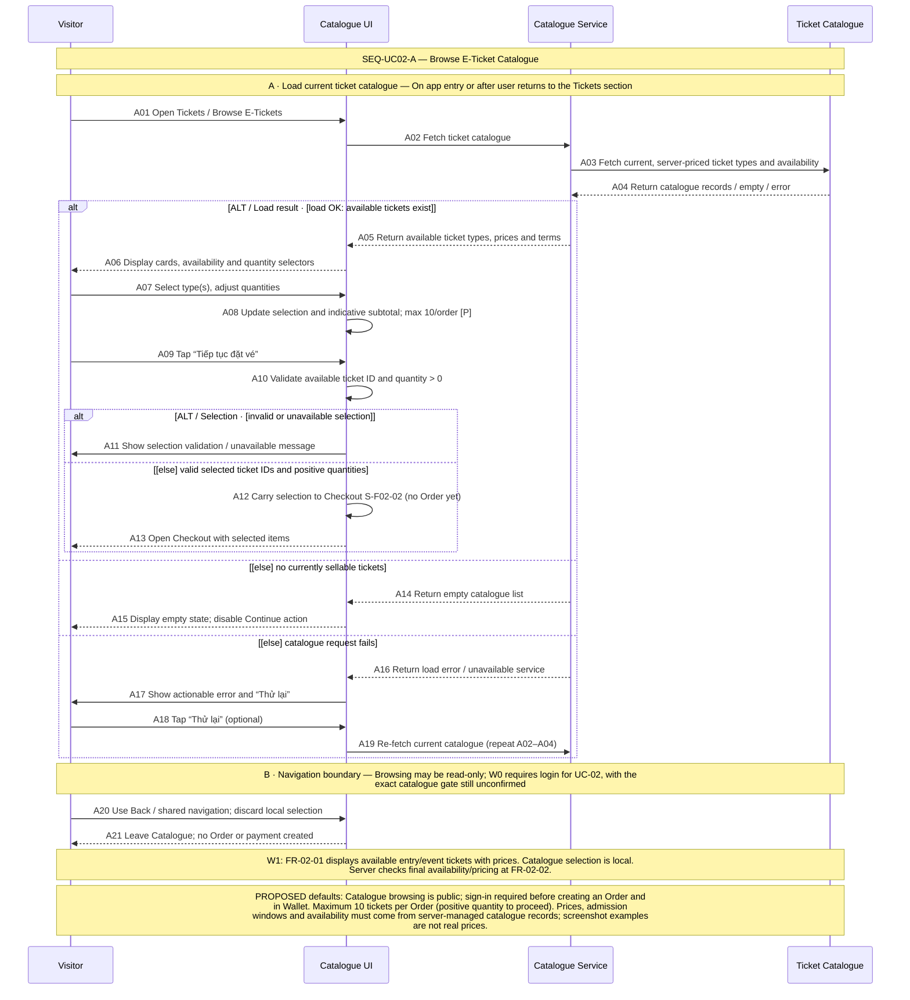
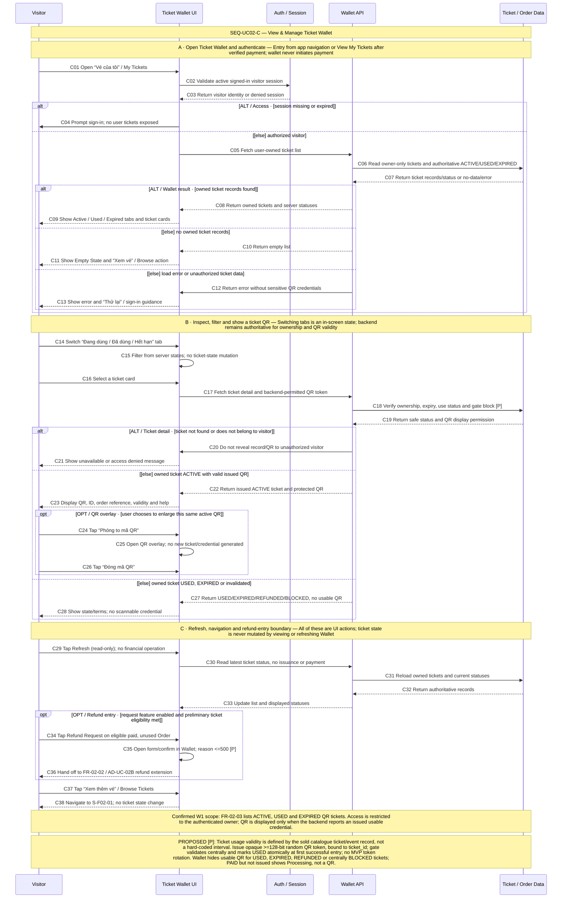

# MySen UC-02 – Sequence Diagrams

## SEQ-UC02-A — Browse E-Ticket Catalogue

AD-UC-02A  ·  FR-02-01 (Must / EQ)  ·  S-F02-01 → S-F02-02  ·  No order or QR is created here

## SEQ-UC02-B — Ticket Checkout & Payment

AD-UC-02B  ·  FR-02-02 (Must / EI)  ·  Purchase + payment exceptions + separate refund-request trigger within ONE function

```mermaid
sequenceDiagram
    accTitle: SEQ-UC02-B — Ticket Checkout & Payment
    participant Visitor as Visitor
    participant MySen_UI as MySen UI
    participant Ticketing_Backend as Ticketing Backend
    participant Order_Ticket_Data as Order / Ticket Data
    participant Payment_Gateway as MoMo / VNPay
    participant QR_Engine as QR / Ticket Engine
    participant Staff_Admin as Staff / Admin
    Note over Visitor,Staff_Admin: SEQ-UC02-B — Ticket Checkout & Payment
    %% AD-UC-02B  ·  FR-02-02 (Must / EI)  ·  Purchase + payment exceptions + separate refund-request trigger within ONE function
    %% UC-02  |  FR-02-01 / FR-02-02 / FR-02-03  |  Based on revised Activities and English Screen Specs  |  Proposed financial rules explicitly labeled
    %% Solid black arrow: request/action     - - - > dashed black arrow: response/callback     ALT / OPT: UML combined fragments     DRAFT: proposed behavior
    Note over Visitor,Staff_Admin: A · Checkout, validate and create Order — Entry from S-F02-01  •  signed-in visitor  •<br/>S-F02-02 checkout screen
    Visitor->>MySen_UI: B01  Open Checkout with ticket IDs and quantities
    MySen_UI->>Ticketing_Backend: B02  Require sign-in#59; validate selected types/qty and latest prices
    Ticketing_Backend->>Order_Ticket_Data: B03  Read sellability, quantity constraints and unit prices
    Order_Ticket_Data-->>Ticketing_Backend: B04  Return current server catalogue / validation result
    alt ALT / Checkout · [invalid selection or unauthenticated session]
    Ticketing_Backend->>MySen_UI: B05  Reject invalid input / unauthenticated session
    MySen_UI-->>Visitor: B06  Show correction or sign-in guidance#59; no Order
    else [else] selection and signed-in session valid
    Ticketing_Backend-->>MySen_UI: B07  Show final payable summary for review
    Visitor->>MySen_UI: B08  Tap “Xác nhận đặt vé”
    MySen_UI->>Ticketing_Backend: B09  Create Order with signed-in user and max 10 tickets [P]
    Ticketing_Backend->>Order_Ticket_Data: B10  Persist PENDING#59; expires 15 min after creation [P]
    Order_Ticket_Data-->>Ticketing_Backend: B11  Return Order ID and authoritative amount
    Ticketing_Backend-->>MySen_UI: B12  Return pending Order and payable amount
    end
    Note over Visitor,Staff_Admin: B · Payment gateway handoff and verified callback — External provider processes payment#59; app<br/>redirect/return alone is NOT payment confirmation
    Visitor->>MySen_UI: B13  Choose MoMo / VNPay#59; tap “Thanh toán”
    MySen_UI->>Ticketing_Backend: B14  Initiate payment for existing Order ID
    Ticketing_Backend->>Order_Ticket_Data: B15  Check 15-min deadline#59; one live attempt#59; retries <=2 [P]
    Order_Ticket_Data-->>Ticketing_Backend: B16  Return Order and payment-attempt eligibility
    Ticketing_Backend->>Payment_Gateway: B17  Create unique, idempotent attempt for same Order ID
    Payment_Gateway-->>Ticketing_Backend: B18  Return hosted payment URL / attempt reference
    Ticketing_Backend-->>MySen_UI: B19  Return trusted provider handoff details
    MySen_UI-->>Visitor: B20  Open provider#59; app return means VERIFYING, not PAID
    Visitor->>Payment_Gateway: B21  Authorize or cancel payment at provider
    Payment_Gateway-->>Ticketing_Backend: B22  Signed provider result or authenticated status query
    Ticketing_Backend->>Ticketing_Backend: B23  Check signature, Order ID, amount, attempt and replay
    Ticketing_Backend->>Order_Ticket_Data: B24  Read Order and attempt#59; lock/guard state transition
    Order_Ticket_Data-->>Ticketing_Backend: B25  Return current Order and attempt state
    alt ALT / Payment · [verified SUCCESS, Order PENDING and within deadline]
    Ticketing_Backend->>Order_Ticket_Data: B26  Commit payment SUCCESS and Order PAID once
    Order_Ticket_Data-->>Ticketing_Backend: B27  Return committed PAID Order
    Ticketing_Backend->>QR_Engine: B28  Idempotently issue one ticket per paid Order line
    QR_Engine->>Order_Ticket_Data: B29  Store ticket, opaque QR token ref and usage window [P]
    Order_Ticket_Data-->>QR_Engine: B30  Return stored issued ticket record(s)
    QR_Engine-->>Ticketing_Backend: B31  Return issuance outcome
    alt ALT / QR issue · [QR ticket record issued and stored successfully]
    Ticketing_Backend-->>MySen_UI: B32  Return TICKET_READY#59; enable View My Tickets
    MySen_UI-->>Visitor: B33  Show success#59; open Wallet S-F02-03 on tap
    else [else] QR issuance not yet confirmed
    Ticketing_Backend->>MySen_UI: B34  Return PAID + ticket processing (no usable placeholder)
    MySen_UI-->>Visitor: B35  Show processing#59; retry issuance at 1/5/15 min [P]
    end
    else [else] verified FAILED or CANCELLED payment attempt
    Ticketing_Backend->>Order_Ticket_Data: B36  Record failed/cancelled attempt#59; Order not PAID
    Ticketing_Backend->>MySen_UI: B37  Show payment not completed#59; no QR
    opt OPT / Retry · [known failed/cancelled attempt#59; unexpired Order#59; team policy allows retry]
    Visitor->>MySen_UI: B38  Retry payment (max 2 retries, before expiry) [P]
    MySen_UI->>Ticketing_Backend: B39  Guard PENDING Order, no active gateway attempt [P]
    Ticketing_Backend->>Order_Ticket_Data: B40  Require <15 min, terminal failed/cancelled attempt
    Order_Ticket_Data-->>Ticketing_Backend: B41  Allow unique next attempt if eligible#59; same Order ID
    Ticketing_Backend->>Payment_Gateway: B42  Create new payment attempt#59; never reuse attempt ID
    end
    Ticketing_Backend-->>MySen_UI: B42x  If retry not allowed, offer Start New Purchase#59; no QR
    else [else] invalid / duplicate / unknown / late SUCCESS
    Ticketing_Backend->>Order_Ticket_Data: B43  Late success on EXPIRED: hold for manual finance review
    Ticketing_Backend->>MySen_UI: B44  Display reconciliation pending#59; no automatic ticket
    Visitor->>MySen_UI: B45  Tap “Kiểm tra trạng thái” (optional)
    MySen_UI->>Ticketing_Backend: B46  Read current Order/attempt/ticket status, no new charge
    Ticketing_Backend->>Order_Ticket_Data: B47  Read Order/payment/ticket status (no new charge)
    Order_Ticket_Data-->>Ticketing_Backend: B48  Return latest stored result
    Ticketing_Backend-->>MySen_UI: B49  Display verified state or still processing
    end
    Note over Visitor,Staff_Admin: C · Independent order-expiry event (proposed) — Not triggered by the user#59; deadline measured<br/>from Order creation, independently of return from gateway
    Ticketing_Backend->>Ticketing_Backend: T01  At Order created_at + 15 min, inspect latest status [P]
    Ticketing_Backend->>Order_Ticket_Data: T02  Expire unpaid PENDING Order only (atomic guard) [P]
    Order_Ticket_Data-->>Ticketing_Backend: T03  Return EXPIRED or unchanged current status
    Ticketing_Backend-->>MySen_UI: T04  Next read displays EXPIRED or current status
    Note over Visitor,Staff_Admin: PROJECT DECISION [P]: Signed-in checkout#59; max 10 tickets per Order#59; authoritative server<br/>total#59; Order PENDING for 15 min from creation. Maximum 2 additional payment attempts, one<br/>in-flight at a time. An expired Order remains expired even if a late payment result arrives#59;<br/>route such funds to manual reconciliation.
    Note over Visitor,Staff_Admin: D1 · OPTIONAL Cancellation & Refund — independent later request — User enters from Ticket<br/>Wallet S-F02-03. This extension belongs to FR-02-02 / AD-UC-02B, NOT a mandatory step after<br/>purchase.
    opt OPT / Refund extension · [optional later refund request for previously PAID ticket (FR-02-02 DRAFT)]
    Visitor->>MySen_UI: R01  Open ticket and select cancellation/refund request
    MySen_UI->>Ticketing_Backend: R02  Fetch preliminary eligibility for owned paid ticket
    Ticketing_Backend->>Order_Ticket_Data: R03  Check owner, PAID, unused/unexpired, age <=24 h [P]
    Order_Ticket_Data-->>Ticketing_Backend: R04  Return full-Order-only terms#59; pre-event + <=24 h [P]
    alt ALT / Refund entry · [unauthorized, ineligible or duplicate request]
    Ticketing_Backend->>MySen_UI: R05  Return rejection reason, no refund transaction initiated
    MySen_UI-->>Visitor: R06  Display ineligible state and recovery guidance
    else [else] eligible to submit request for manual review (policy pending)
    Ticketing_Backend-->>MySen_UI: R07  Return request form, full refund amount and terms [P]
    Visitor->>MySen_UI: R08  Optional reason (<=500 chars)#59; tap Request Refund [P]
    MySen_UI->>MySen_UI: R09  Confirm modal: full Order, no automatic refund [P]
    alt ALT / Confirm request · [user cancels / closes confirmation modal]
    MySen_UI-->>Visitor: R10  Close modal#59; do not create refund request
    else [else] user explicitly confirms refund request
    Visitor->>MySen_UI: R11  Tap Confirm Request
    MySen_UI->>Ticketing_Backend: R12  Submit once per Order#59; unique request key [P]
    Ticketing_Backend->>Order_Ticket_Data: R13  Recheck eligibility#59; persist REVIEWING once [P]
    Order_Ticket_Data-->>Ticketing_Backend: R14  Return request ID and pending-review state
    Ticketing_Backend-->>MySen_UI: R15  Return request accepted for REVIEW, not refunded
    MySen_UI-->>Visitor: R16  Show awaiting Admin review#59; offer Check Status
    Ticketing_Backend->>Staff_Admin: R17  Assign Operations Admin manual review (2 days) [P]
    Note over Visitor,Staff_Admin: D2 · Manual decision and original-provider refund — Staff/Admin review is required by W0#59;<br/>approval does not by itself prove money returned.
    Staff_Admin->>Ticketing_Backend: R18  Admin approve/reject#59; record reason and approver [P]
    alt ALT / Admin review · [manual reviewer REJECTS request]
    Ticketing_Backend->>Order_Ticket_Data: R19  Persist rejected decision and reason#59; no provider call
    Ticketing_Backend-->>MySen_UI: R20  Make REJECTED review status visible in Wallet
    MySen_UI-->>Visitor: R21  Show rejection reason, no QR invalidation
    else [else] manual reviewer APPROVES request
    Ticketing_Backend->>Order_Ticket_Data: R22  Approve 100% original paid amount, no partial [P]
    Ticketing_Backend->>Order_Ticket_Data: R23  Set REFUND_PENDING after Admin approval [P]
    Ticketing_Backend->>Payment_Gateway: R24  Refund original txn via enabled provider adapter [P]
    Payment_Gateway-->>Ticketing_Backend: R25  Receive provider result#59; timeout => status query [P]
    Ticketing_Backend->>Ticketing_Backend: R26  Verify signed refund ref, amount, source and replay
    alt ALT / Provider result · [verified SUCCESS reported by original provider]
    Ticketing_Backend->>Order_Ticket_Data: R27  Record verified SUCCESS#59; begin QR revocation
    Ticketing_Backend->>QR_Engine: R28  Revoke all unused ticket QR tokens on refunded Order
    QR_Engine->>Order_Ticket_Data: R29  Update ticket / credential usability for affected tickets
    Order_Ticket_Data-->>QR_Engine: R30  Return persisted QR usability update / error
    QR_Engine-->>Ticketing_Backend: R31  Report QR revocation outcome
    alt ALT / QR sync · [QR invalidation persisted successfully]
    Ticketing_Backend->>Order_Ticket_Data: R32  Commit REFUNDED after provider success + QR sync [P]
    Ticketing_Backend-->>MySen_UI: R33  Return confirmed refund and unusable QR status
    MySen_UI-->>Visitor: R34  Display Refunded#59; QR not usable
    else [else] QR invalidation not confirmed despite provider success
    Ticketing_Backend->>Order_Ticket_Data: R35  Hold REFUND_SETTLED_QR_SYNC#59; block gate [P]
    Ticketing_Backend->>Staff_Admin: R36  Retry QR at 1/5/15 min#59; alert Admin if unresolved [P]
    Ticketing_Backend->>MySen_UI: R37  Show refund verified, ticket lock syncing [P]
    end
    else [else] provider PENDING or no final verified response
    Ticketing_Backend->>Order_Ticket_Data: R38  Pending: status query at 30 min#59; escalate 24 h [P]
    Ticketing_Backend->>MySen_UI: R39  Return pending refund and Check Status action
    MySen_UI-->>Visitor: R40  Show Pending#59; do not promise refund or QR invalidation
    else [else] verified provider FAILED / rejected
    Ticketing_Backend->>Order_Ticket_Data: R41  Mark REFUND_FAILED / adapter unsupported#59; Admin follow-up [P]
    Ticketing_Backend->>MySen_UI: R42  Return refund failure state, not REFUNDED
    MySen_UI-->>Visitor: R43  Show failure and support/follow-up guidance
    end
    end
    end
    end
    Note over Visitor,Staff_Admin: D3 · Late refund callback, duplicate delivery and status refresh — Deferred provider update is<br/>asynchronous. The exact gateway callback/polling contract is unconfirmed.
    opt OPT / Deferred update · [refund remains pending or unresolved after initial response]
    Payment_Gateway-->>Ticketing_Backend: R44  Later provider callback or status-query result [P]
    Ticketing_Backend->>Ticketing_Backend: R45  Validate authenticity, refund reference and idempotency
    Ticketing_Backend->>Order_Ticket_Data: R46  Check stored refund state and prior processed events
    Order_Ticket_Data-->>Ticketing_Backend: R47  Return current state and deduplication result
    alt ALT / Late result · [first verified SUCCESS and eligible pending refund]
    Ticketing_Backend->>Order_Ticket_Data: R48  Store verified late SUCCESS#59; enter QR sync state
    Ticketing_Backend->>QR_Engine: R49  Revoke affected ticket QR credentials after late SUCCESS
    QR_Engine->>Order_Ticket_Data: R50  Persist revocation or return failure
    QR_Engine-->>Ticketing_Backend: R51  Return QR revocation result
    alt ALT / Late QR sync · [QR revocation confirmed]
    Ticketing_Backend->>Order_Ticket_Data: R52  Finalize refund and ticket status [proposed]
    Ticketing_Backend-->>MySen_UI: R53  Expose verified Refunded + QR invalidated state
    else [else] QR revocation failed or uncertain
    Ticketing_Backend->>Order_Ticket_Data: R54  Hold QR-sync incident#59; central gate deny [P]
    Ticketing_Backend->>Staff_Admin: R55  Urgent Ops alert#59; 1/5/15 min retry then manual [P]
    end
    else [else] verified FAILED after pending
    Ticketing_Backend->>Order_Ticket_Data: R56  Verified FAILED: refund not completed, QR unchanged
    else [else] duplicate / invalid / still PENDING
    Ticketing_Backend->>Order_Ticket_Data: R57  Ignore duplicate/invalid event#59; retain authoritative state
    end
    end
    Visitor->>MySen_UI: R58  Tap Check Status#59; no refund retry side effect
    MySen_UI->>Ticketing_Backend: R59  Read latest review/refund/ticket status (READ ONLY)
    Ticketing_Backend->>Order_Ticket_Data: R60  Fetch authoritative request, provider and QR state
    Order_Ticket_Data-->>Ticketing_Backend: R61  Return current stored result
    Ticketing_Backend-->>MySen_UI: R62  Return latest verified state#59; no financial side effects
    MySen_UI-->>Visitor: R63  Show Reviewing / Pending / Rejected / Failed / Refunded
    end
    Note over Visitor,Staff_Admin: APPROVED W0: automatic cash refund is out of scope. Every refund requires manual Operations<br/>Admin verification. The refund sequence is a proposed extension INSIDE AD-UC-02B / FR-02-02#59;<br/>W1 EARS has not formally approved the detailed refund policy.
    Note over Visitor,Staff_Admin: PROJECT REFUND POLICY [P]: Full-Order refund only#59; within 24 h of successful payment, before<br/>ticket expiry/event start, and only when all tickets are unused. Reason optional, maximum 500<br/>characters. Admin decides within 2 business days#59; no automatic approval. Original payment<br/>provider only#59; bank/provider status must be verified before REFUNDED.
```

## SEQ-UC02-C — View & Manage Ticket Wallet

AD-UC-02C  ·  FR-02-03 (Must / EQ)  ·  S-F02-03  ·  Active / Used / Expired ticket listing and protected QR

