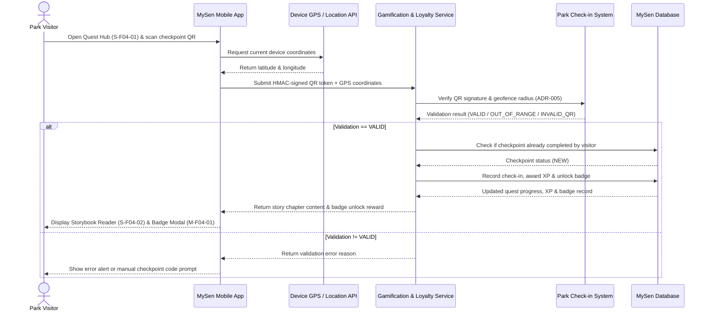

# Sequence Diagram: SD-UC-04 Scan Checkpoint QR & Gamification

Lesson 4, analysis level: how the parts of MySen talk to each other when a visitor scans a physical checkpoint QR code to verify proximity (`ADR-005`), unlock a story chapter, and earn XP and badges. The visitor's choices and fallback manual entry flow are shown in the activity diagram [AD-UC-04](../activity/AD-UC-04.md).

| Field | Value |
| --- | --- |
| Use case | UC-04 Scan Checkpoint QR & Gamification |
| Version | v1.0 |
| FRs | FR-04-01 to FR-04-05 |

## Diagram

## Notes

* **Lifelines:** Align directly with the elements in [architecture.md](../architecture/architecture.md) and external entities in [context-diagram.md](../context/context-diagram.md).
* **Anti-cheat Security:** Both the cryptographic QR signature and GPS geofence must pass before XP or badges are credited (`ADR-005`).