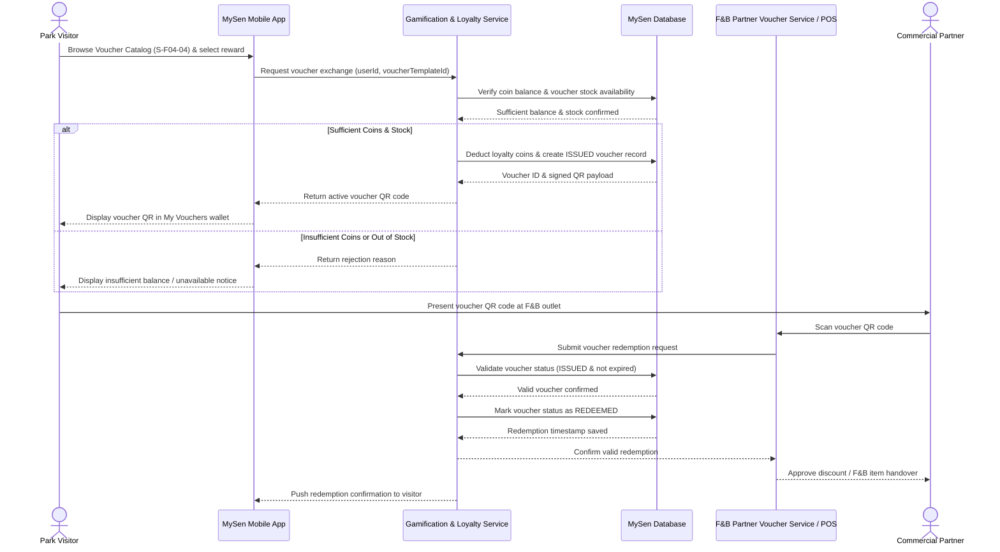

# Sequence Diagram: SD-UC-05 Redeem Points for Voucher & Rewards

Lesson 4, analysis level: how the parts of MySen talk to each other when a visitor exchanges earned loyalty coins for an F&B voucher and redeems it at a partner booth. Automated daily streak resets and reminders (`ADR-004`) are shown in the activity diagram [AD-UC-05](../activity/AD-UC-05.md).

| Field | Value |
| --- | --- |
| Use case | UC-05 Redeem Points for Voucher & Rewards |
| Version | v1.0 |
| FRs | FR-04-06 to FR-04-10 |

## Diagram

## Notes

* **Lifelines:** Align directly with the elements in [architecture.md](../architecture/architecture.md) and external entities in [context-diagram.md](../context/context-diagram.md).
* **Separation of Concerns:** Loyalty coin voucher redemption (`UC-05`) is strictly separated from real-money e-ticket purchases (`UC-02`).