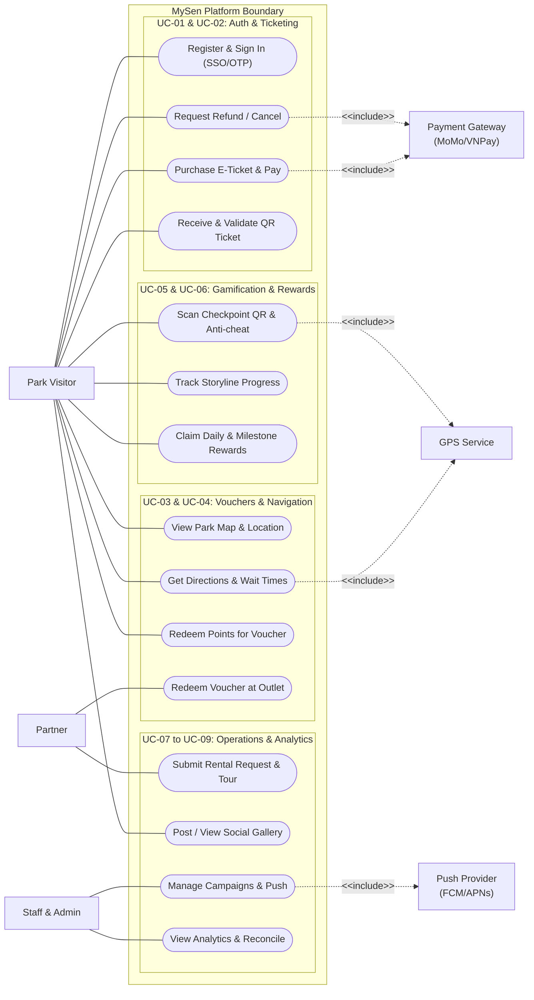

# Use Case Diagram: MySen Platform

Lesson 4 (Prof. Seki). Who wants MySen Platform to do what. Mermaid has no native UML use case diagram type, so the diagram below is drawn as a flowchart: actors on the outside, use cases (rounded) grouped by domain inside the system boundary. In a drawing tool, standard UML notation (stick figures, ovals, and `<<include>>` stereotypes) is used.

| Field | Value |
|---|---|
| Version | v2 |
| Actors | Park Visitor, Partner, Staff & Admin (primary); Payment Gateway (MoMo/VNPay), GPS Service, Push Provider (FCM/APNs) (secondary) |

## Diagram

The full use case inventory, with features and login rules, is W0 Table 1 in [w0-scope.md](../function-list/w0-scope.md).

## Sequence diagrams

One sequence diagram per core use case, at analysis level: the lifelines are the elements of the [physical design](../architecture/architecture.md).

| Use case | Sequence diagram | Status |
|---|---|---|
| UC-01 Register & Sign In | SD-UC-01 | Open: to be drawn (Owner: Hiệp) |
| UC-02 Purchase E-Ticket & Pay | [SD-UC-02](SD-UC-02.md) | Core flow (Owner: Nguyệt Minh) |
| UC-04 Scan Checkpoint QR & Gamification | [SD-UC-04](SD-UC-04.md) | Core flow (Owner: Long) |
| UC-05 Redeem Points for Voucher & Rewards | [SD-UC-05](SD-UC-05.md) | Core flow (Owner: Bảo Ngân) |
| UC-03, UC-06 to UC-09 | (optional / covered by activity diagrams) | Documented in [activity-index](../activity/activity-index.md) |

## Change log

| Version | When | Change | Why |
|---|---|---|---|
| v1 | Lesson 4 | Initial use cases across Auth, Ticketing, Map, Gamification, Social, and Admin | Baseline functional scope from CVCA and Context Diagram |
| v2 | Lesson 7 | Added `<<include>>` dependencies for GPS Service (QR anti-cheat) and Push Provider (FCM/APNs) | Activity modeling (`AD-UC-04`, `AD-UC-05`) required geofence verification and automated push alerts |
