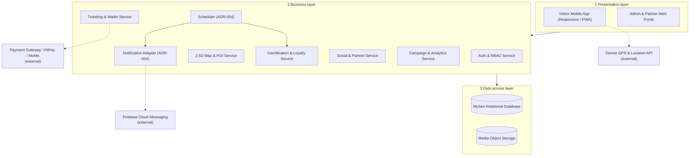

# Architecture: MySen Platform

Lesson 4 (Architectural Design). Follows the standard design process: stakeholder requirements, system requirements, functional design, physical design (three-layer architecture), and Architecture Decision Records in [`adr/`](adr/).

| Field | Value | 
| ----- | ----- | 
| Version | v2 | 
| Inputs | CVCA, Context Diagram, Use Case Diagram, [W0 Scope](../w0-scope.md), [W1 Function List](../w1-function-list.md) | 

## 1. System requirements

| ID | System requirement | From | 
| ----- | ----- | ----- | 
| SyR-01 | The system shall authenticate visitors, commercial partners, and administrators with role-based access control. | F-00 / UC-01 | 
| SyR-02 | The system shall allow visitors to browse, purchase e-tickets via payment gateways, and store QR tickets in a digital wallet. | F-02 / UC-02 | 
| SyR-03 | The system shall provide an interactive 2.5D park map with POI details and real-time navigation. | F-03 / UC-03 | 
| SyR-04 | The system shall let visitors scan checkpoint QR codes with anti-cheat verification to unlock storybooks, XP, and badges. | F-04 / UC-04 | 
| SyR-05 | The system shall track daily login streaks, award loyalty coins, and let visitors redeem coins for F&B vouchers. | F-04 / UC-05 | 
| SyR-06 | The system shall provide a social photo gallery for visitors and a space rental request workflow for commercial partners. | F-05 / UC-06, UC-11 | 
| SyR-07 | The system shall allow administrators to manage marketing campaigns, send push notifications, and view operational analytics. | F-06 / UC-08, UC-09, UC-10 | 

Detailed testable criteria for each requirement are defined in EARS format in [W1 Function List](../w1-function-list.md).

## 2. Functional design

| Function | Serves | 
| ----- | ----- | 
| Authenticate users and enforce role permissions | all | 
| Process ticket orders, payment callbacks, and QR ticket wallet | SyR-02 | 
| Serve 2.5D map coordinates, POI metadata, and route guidance | SyR-03 | 
| Validate checkpoint QR tokens & GPS proximity; unlock lore and rewards | SyR-04 | 
| Track daily check-in streaks, coin ledger, and voucher redemptions | SyR-05 | 
| Manage social photo uploads, likes, and partner space rental applications | SyR-06 | 
| Schedule automated streak reminders and end-of-day resets | SyR-05, SyR-07 | 
| Manage campaigns, dispatch push notifications, and aggregate analytics | SyR-07 | 

## 3. Physical design

Solid arrows represent internal layer-to-layer calls; dotted arrows represent integrations with external services.

| Function | Element | Layer | 
| ----- | ----- | ----- | 
| Authenticate users & enforce roles | Auth & RBAC Service ([ADR-002](adr/ADR-002-auth-rbac.md)) | Presentation, Business | 
| Process ticket orders & payment gateways | Ticketing & Wallet Service + Payment Gateway ([ADR-003](adr/ADR-003-payment-gateway.md)) | Business, External | 
| Serve 2.5D map & navigation nodes | 2.5D Map & POI Service + Device GPS | Business, External | 
| Validate checkpoint QR & GPS anti-cheat | Gamification & Loyalty Service ([ADR-005](adr/ADR-005-qr-gps-anticheat.md)) | Business, External | 
| Track daily streaks & redeem vouchers | Gamification & Loyalty Service | Business | 
| Manage social gallery & partner rentals | Social & Partner Service + Media Object Storage | Business, Data access | 
| Run daily streak resets & push reminders | Scheduler + Notification Adapter ([ADR-004](adr/ADR-004-scheduler-notifications.md)) | Business, External | 
| Persist users, tickets, quests, coins, posts | MySen Relational Database | Data access | 

## 4. Architecture Decision Records (ADRs)

| ADR | Decision | Status | 
| ----- | ----- | ----- | 
| [ADR-001](adr/ADR-001-responsive-pwa-and-portal.md) | Responsive mobile web app (PWA) for visitors and unified web portal for admin/partners | Accepted | 
| [ADR-002](adr/ADR-002-auth-rbac.md) | Token-based authentication (JWT) with Role-Based Access Control (Visitor, Partner, Admin) | Accepted | 
| [ADR-003](adr/ADR-003-payment-gateway.md) | Integrate external payment gateways (VNPay/MoMo) via webhook callbacks for e-tickets | Accepted | 
| [ADR-004](adr/ADR-004-scheduler-notifications.md) | Dedicated background scheduler and Firebase Cloud Messaging (FCM) for streak jobs and alerts | Accepted (Lesson 7) | 
| [ADR-005](adr/ADR-005-qr-gps-anticheat.md) | Validate HMAC-signed QR tokens combined with GPS geofencing for checkpoint check-ins | Accepted (Lesson 7) | 

## Change log

| Version | When | Change | Why | 
| ----- | ----- | ----- | ----- | 
| v1 | Lesson 4 | Initial 3-layer architecture with core services, payment gateway, and database | Baseline scope from CVCA and Use Case Diagram | 
| v2 | Lesson 7 | Added Scheduler (`ADR-004`) and QR/GPS anti-cheat validation (`ADR-005`) | Activity diagrams (`AD-UC-04`, `AD-UC-05`) revealed automated daily streak resets and checkpoint spoofing risks | 